+++
title = "虹は凶兆"
date = 2026-10-18T00:00:00+09:00
draft = false
tags = ["船", "仕事", "廃墟", "留学", "ストリート"]
+++
今日は朝から小樽港近くで虹が出ていました。
サンジ君は、「虹が出ると荒れんだ。」と教えてくれました。
陸ではみんな喜びますが、海での虹は凶兆だそうです。
朝食後主機の起動を任されました。
結果はだいたいの流れが間違っていなかったという評で、成功でした。
ただ、最後のインジケータコックを閉め忘れたこと。もし、閉め忘れてたら、起動したとき音がなるから気付くこと。
コックは、軽くでいいけど最後まで閉めること。指摘されました。
ターニングする際に、はずみ車の上の方の歯に噛ませないと固いということも教わりました。
その後揚錨を始めるころになると海が荒れ模様となり、小樽の波止場に、5mくらいの波が打ち付けていたのが見えました。
仕事を終えワッチを始めると揺れが強くなり、8度程度の傾きが5秒くらいの波長で来るようになりました。
ワッチ中に座る椅子が大きく動き始めたほどです。最初は元気だったのですが、1時間もたつと具合が悪くなってきました。  

しかし、今日のワッチ中の課題は主機冷却海水ポンプの系統を知る事でした。
大きな揺れの中、下を向いて機関場の床板をマイナスドライバーでひっくり返していくことで、床下を通る配管を一つずつ辿りました。
主機冷却海水ポンプとそれにつながる取水の船底のバルブは見つけました。
しかし、３分岐している場所があり、混乱してしまいました。外の空気を吸ってから再トライ。  

主機インタークーラーと、LO・清水の冷却器に繋がる系統から分岐した。
減速機の冷却器に繋がる系統  
中間軸受の系統  
船尾管の系統  
3つを何とかたどることに成功しました。バルブについては、床に丸い穴が開いてる部分なので、それを手掛かりに床をひっくり返すと理解しやすかったです。
渡されている配管図が結構分かりやすく、実際の配管もわりと最短距離を通っているので、分かってしまえばそこまで苦労はしなさそうですが、最初がかなり辛かったですね。
明日もう一度復習しないといけないですね。  

午後は、船酔いでダウンしていましたが、2時ごろから元気を出して機関場を見て回りました。
一応NO.1主機清水ポンプの系統について調べました。
主機清水ポンプの系統は、排水口はありません。機械の中を通るからです。
機関場の天井の上に、膨張タンクというのがあり、そこから補給されています。
主機清水ポンプから来た水は、そこそこ長い経路を通り、主機の下側から機械の中を通って上の方に抜けます。リービッヒ冷却管と同じように冷却水は下から上に送るのです。
そこで、またポンプに送られます。そこまで難しくはない輪っかの経路になっています。  

補機の冷却清水の系統も見ました。補機の冷却水の系統は、カロリーファイヤ、ポンプ、機械内部を循環しています。補機の冷却水を温める系統は冬場に使うそうですが、基本的に輪っかの系統です。
ただ、よくわからなかったので、もう一度見たいです。  

最後にお風呂の沸かし方をもう一度やりました。
- まず、海水のバルブを半回転させる。お風呂を見に行って、汚れた水を受ける。
- そして、カロリーファイヤバルブとポンプに繋がるバルブを開けて、もう一度お風呂に行って冷海水の蛇口も開いて、汚れた水を受ける。
- 温度がいい感じであれば、それを貯める。
- ヒータについてる温度計を見て、46度になるようにバルブを繊細に調整する。  

今日は仕事もあったし、新しいことも多いし、揺れるしで大変でしたが、近海船に比べればハナクソみたいなものです。
なので、小噺も書いてしまいたいです。  

私が、大学4年生の頃に廃墟に行っていた話です。
一般的に、廃墟は危ない・違法というイメージです。そんな場所にわざわざ立ち寄るには理由があるのです。
私は、高校生の頃HIPHOPをやっていたこともあり、サグやアングラに一応触れたことはあったのですが、葉っぱは吸う気持ちになれないし、ドンキでたむろするのもガラじゃないし。という感じでそういう文化を体現することはあまりしてきませんでした。
それでも、自分の中に「何かを壊したい」という気持ちが溢れているのは知っていましたから、何か見つけたい気持ちがありました。
そんななか、インドネシア留学に行った際何となく立ち寄った場所に衝撃を受けます。滞在していた寮の隣にあった川沿いの貧民街です。  
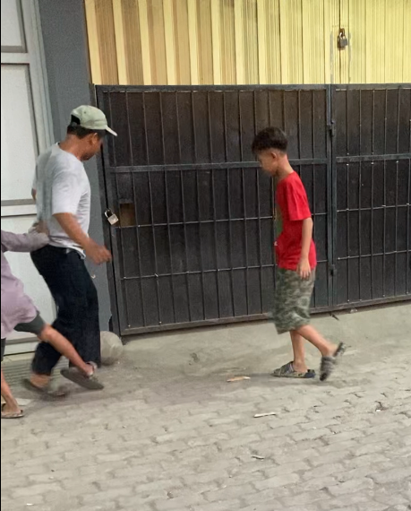  
サンダルでサッカーをプレイするガキ、BGMはムスリムの祈りです。
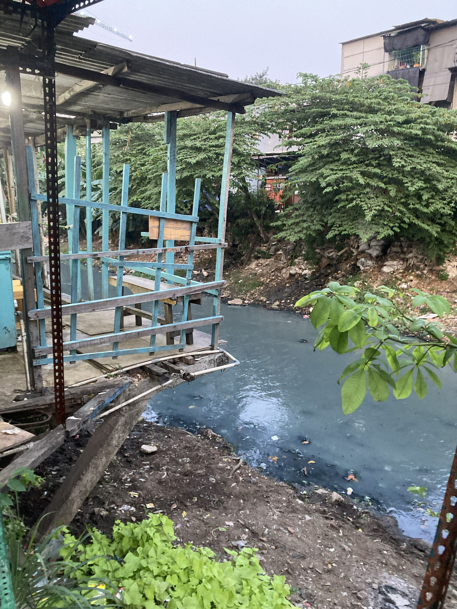
川が水色です。
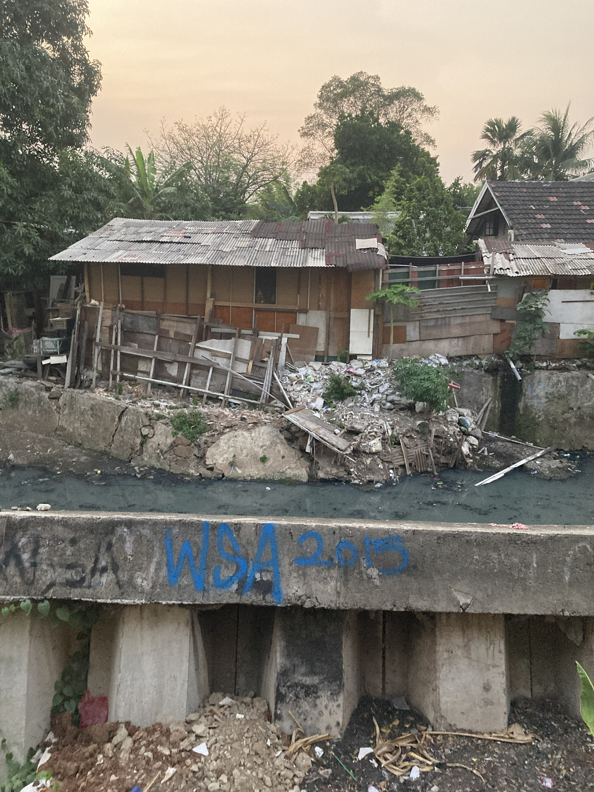
崩壊しかかった家がとても美しかったです。
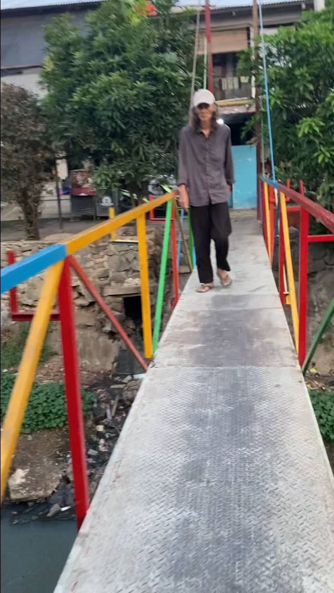
川にかかる橋はカラフルでした。  
このように、秩序だっていなくて、豊かでもないが、カラフルで壊れかけでエネルギーに満ちているという
光景を目にして、高揚感やワクワクを感じました。また、いつ襲われるかわからない。というような緊張感もありました。
「何かを壊したい」というような欲求がインドネシアのストリートで満たされたのです。  
日本に帰った後、同じようなものが日本にないかなと調べました。すると、人はほとんどいないものの、廃墟で同様の体験ができそうだ。と考えるようになりました。
つまり、わざわざ悪いことをしようとしていたのではなく、インドネシアで楽しかった経験を日本で再現しようとしたら、廃墟探索という行動に自然とたどり着いたのです。
大学4年生になると、奇跡的に車を運転してくれる友人や興味を持ってくれた友人に恵まれ廃墟に行くことが出来ました。一人では危なくていけないですからね。その時の写真を一部掲載します。
廃墟の中でもグラフィティ系から攻めていったことで、絵画鑑賞のような要素もありインドネシアのストリートとはまた違った要素を楽しめました。    
大学4年の11月  
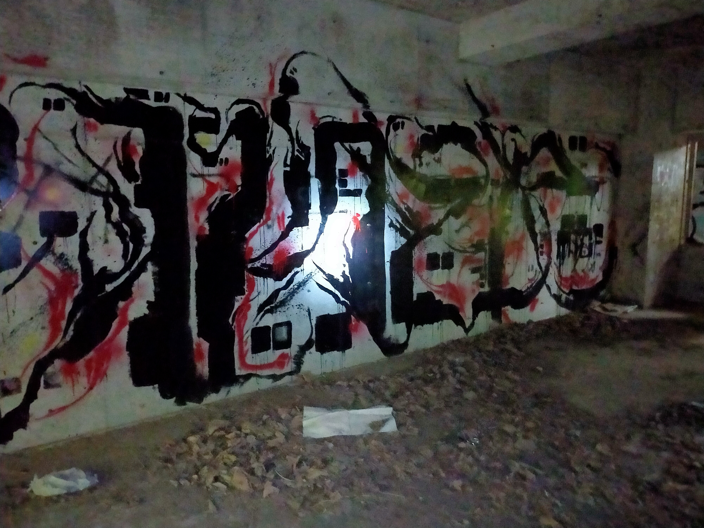
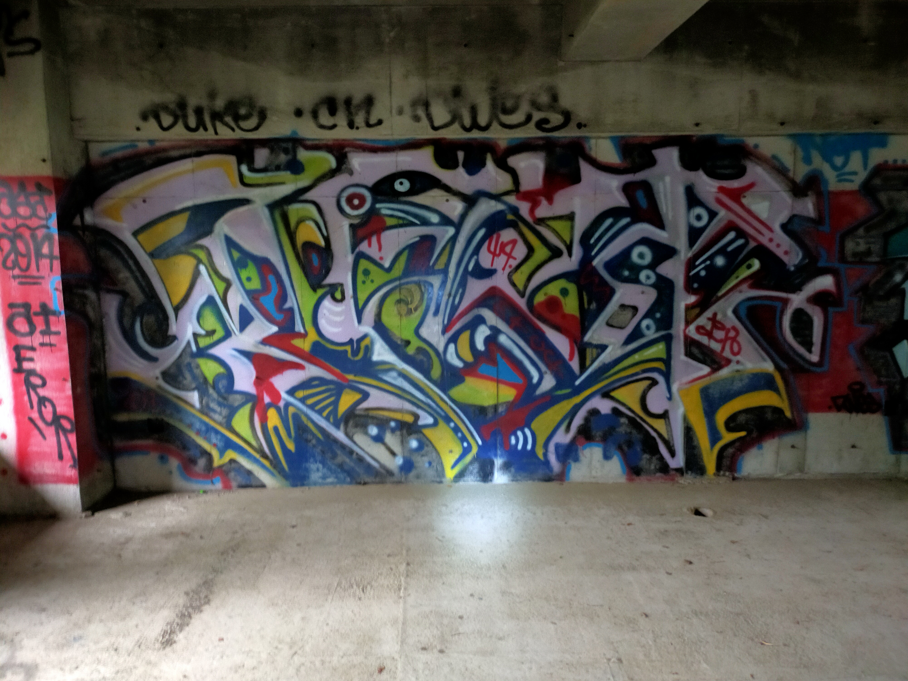
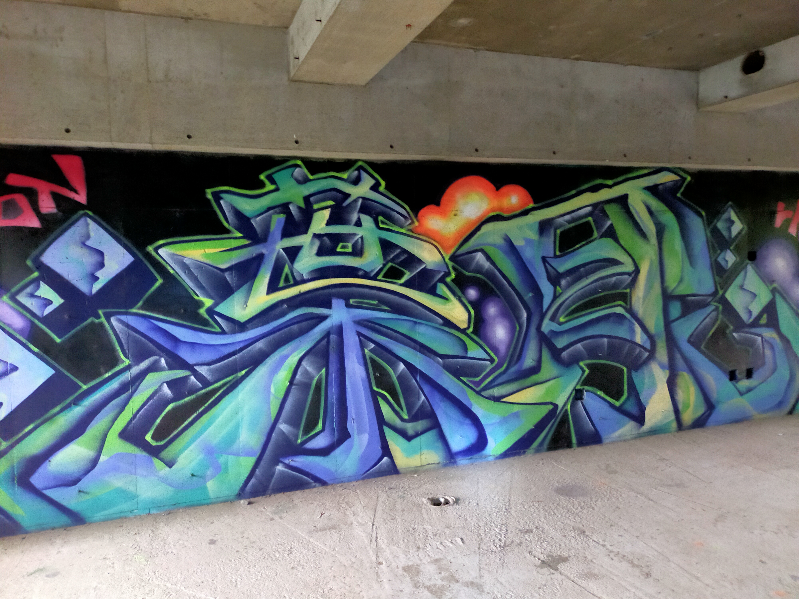
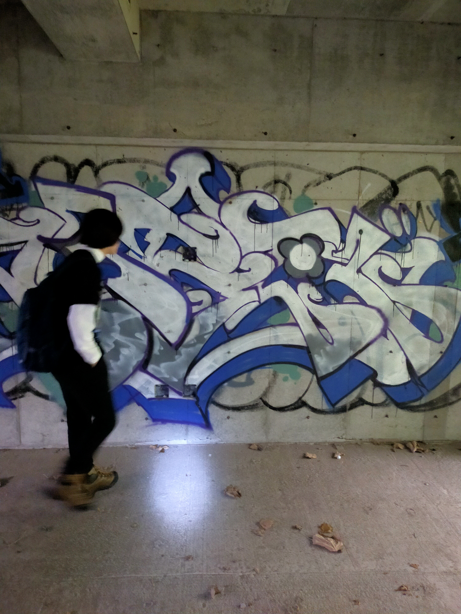
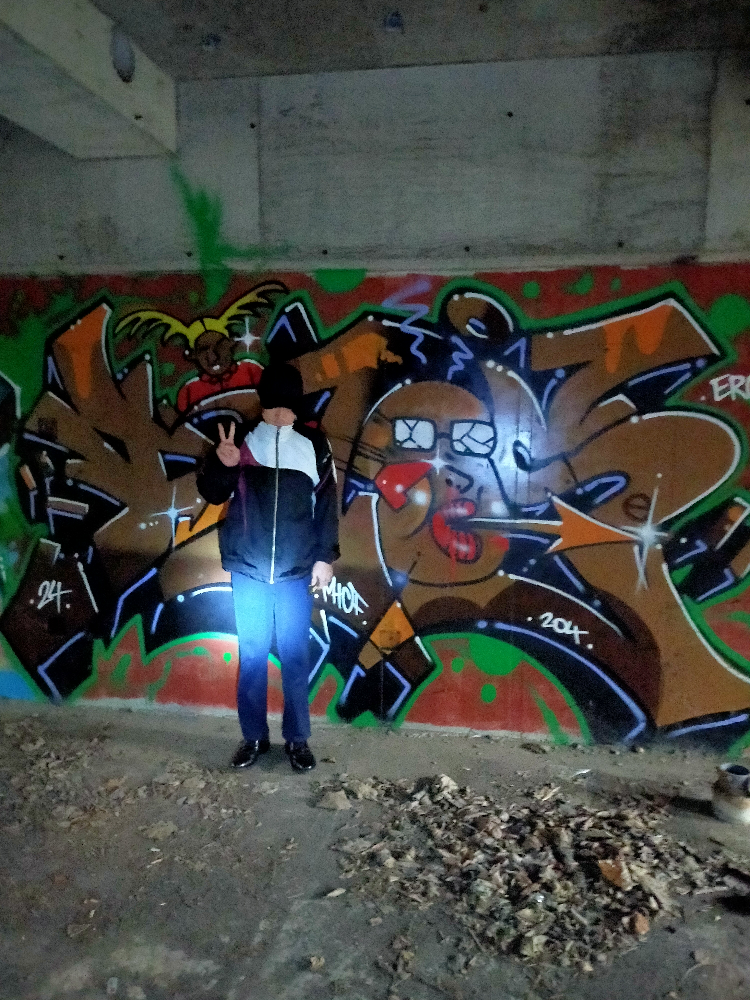
大学4年の3月（卒業旅行）  
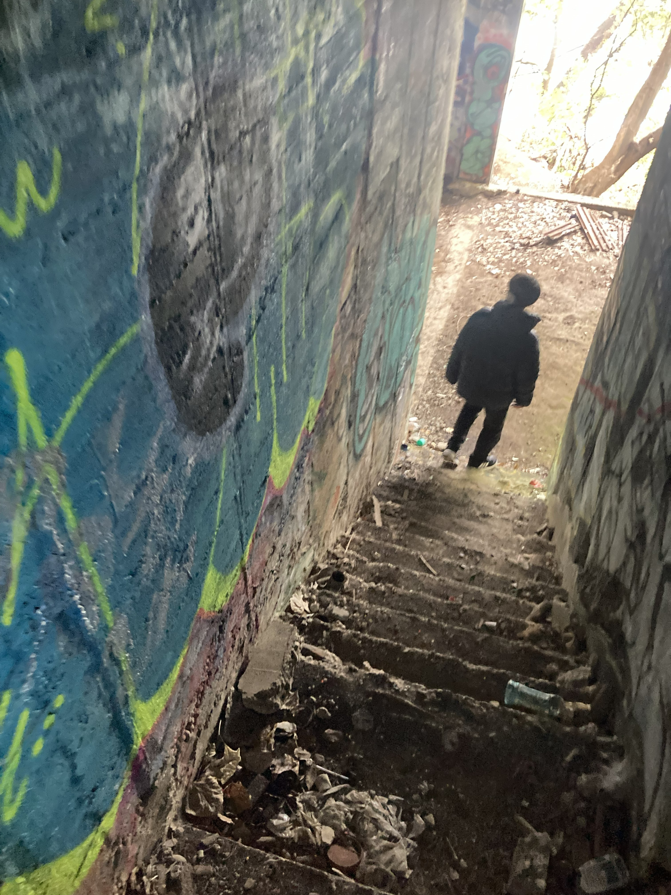
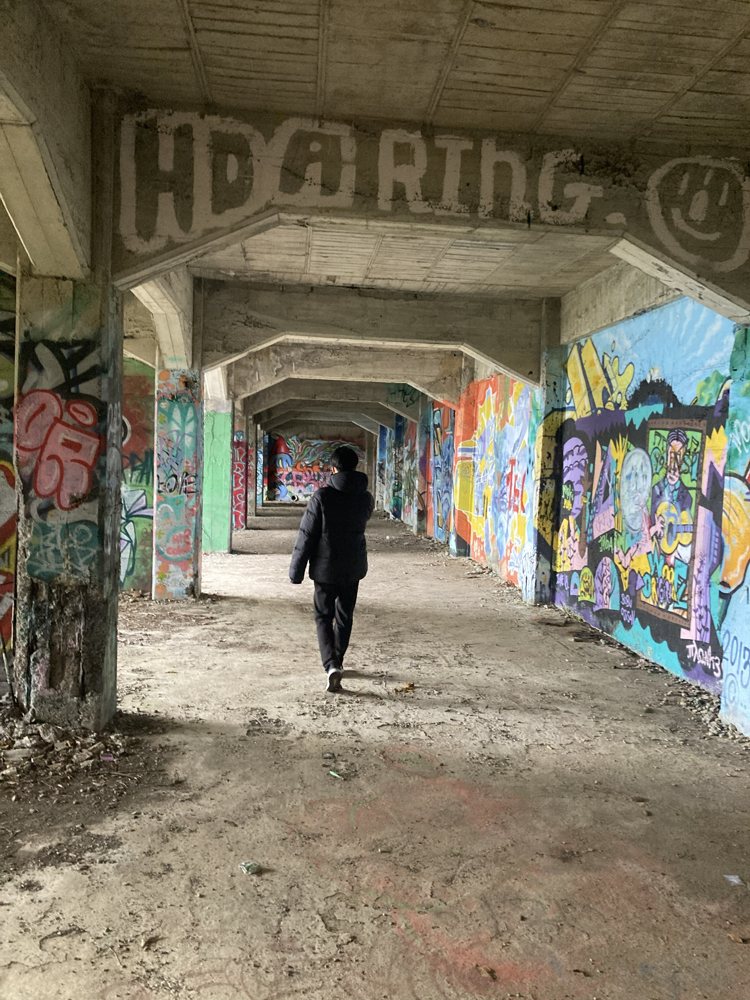
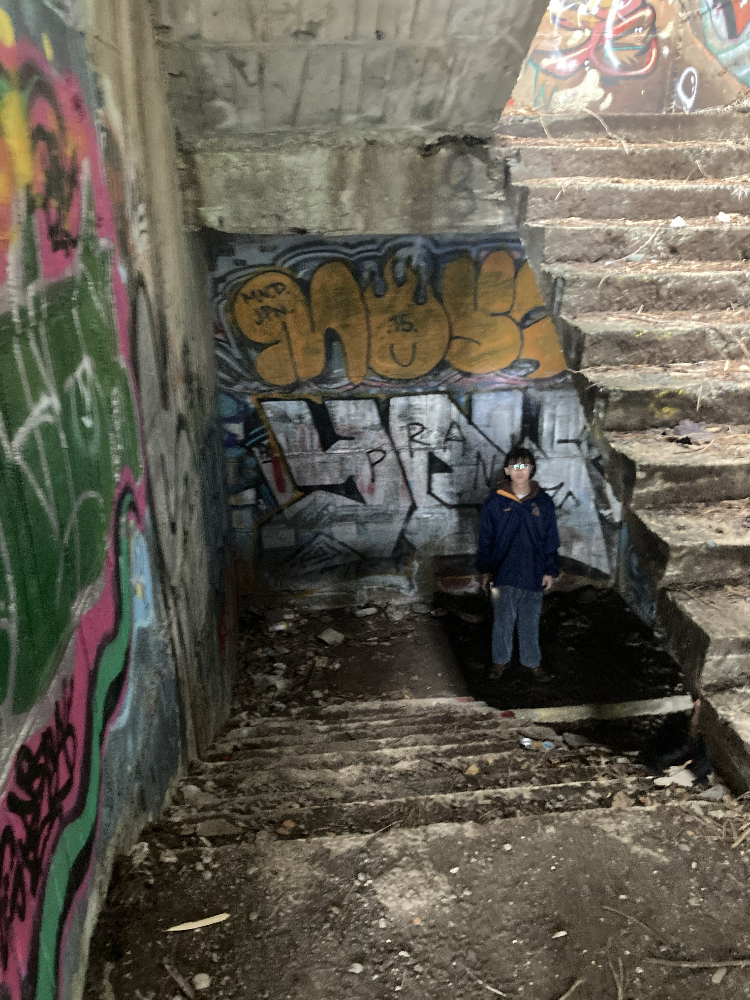
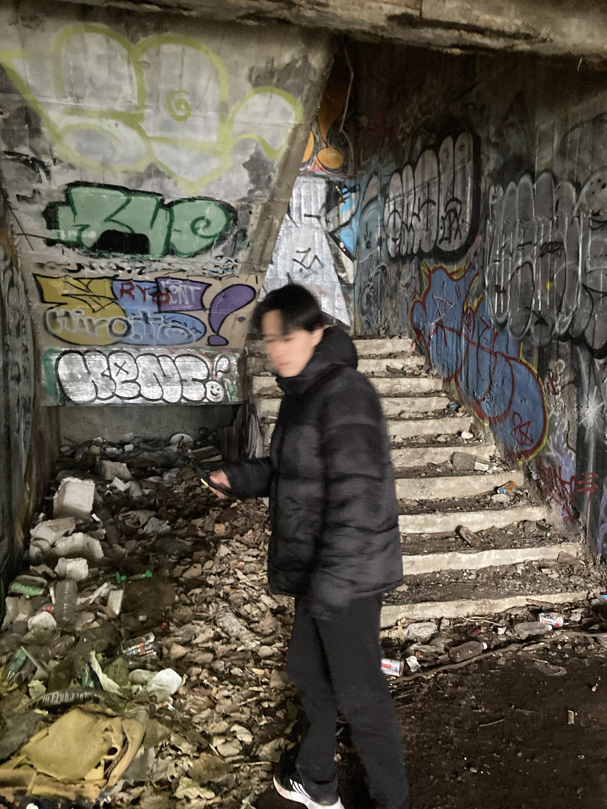

大学4年の11月の会で撮った一場面は、100号の絵になっています。  
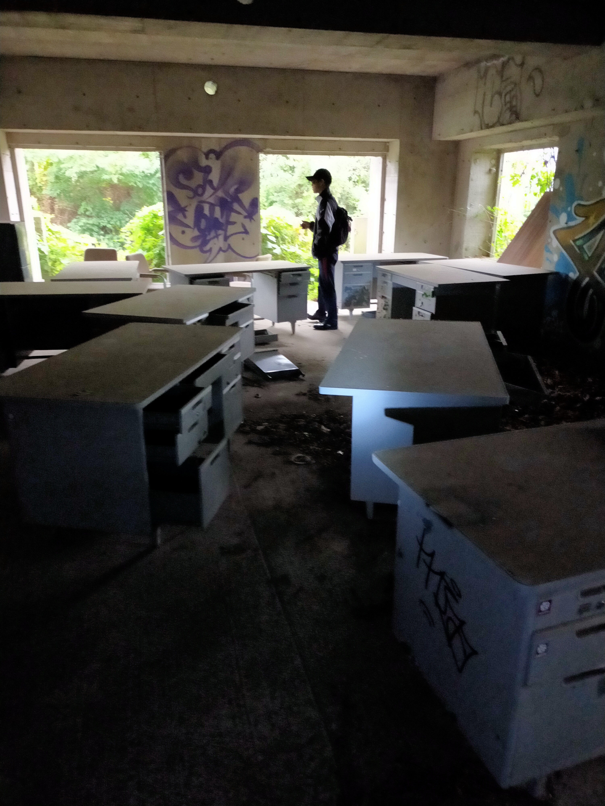
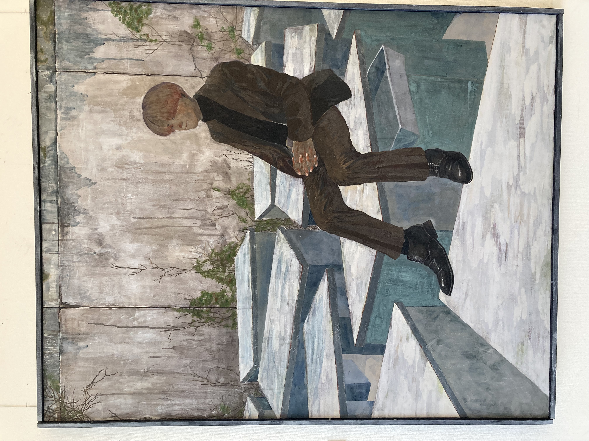  

この机は多分産業廃棄物です。  
注）廃墟探索はおススメはしません。場所の問い合わせも受け付けていません。自分で調べてください。何故なら私は責任を負えないからです。

