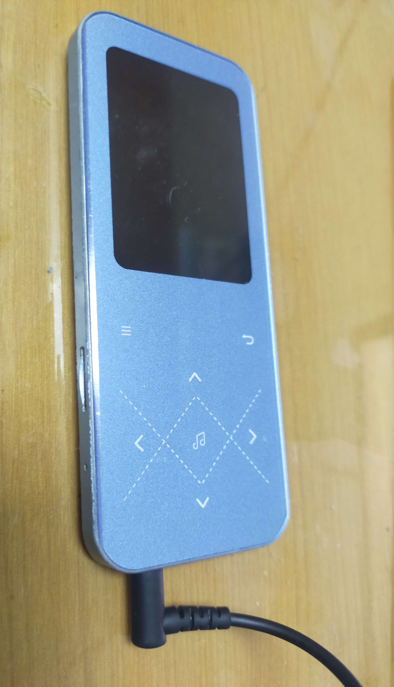

+++
title = "北の海は厳しい"
date = 2026-10-20T00:00:00+09:00
draft = false
tags = ["船", "仕事", "音楽"]
+++
今日の朝はご飯まで仕事はありませんでした。
しかし、寒すぎてあまり朝の時間を楽しめませんでした。
下の階の部屋は、喫水線より下なので海水温が下がるとその分気温が下がります。
昨日の海水温は16度だったので、10月にして室温が関東の冬場くらいの気温になりました。

今日学んだことについて、復習します。
船尾管のアースは船体とプロペラ軸との摩擦で起きる電食を回避するために設置されているそうです。
スラッジタンクというのは何かと教わりました。船外排出のビルジウェルとは異なり、油を流したりするのに使うそうです。
洗面台はビルジウェルにつなっがっているので、油を流したりするとダメなことを知りました。
ゲージを見てたまってきたら、陸揚げしているそうです。
FOポンプからはFO弁に繋がっている。
機械は様々なメーカーのものを組み合わせて使用している。
ポンプもポンプと駆動部のモーターの会社は違う。
減速機もクラッチと減速機本体の会社が違う。
エンジンと発電機も会社が違う。
だから、一つの機械だからと言って、説明書を読めば全部わかるとは限らない。

床を開けて系統について復習しました。
海水系統に関してはだいたいわかりました。
LO系統も主機に関してはだいたいわかりました。
補機のLO系統はよくわかりません。
補機の清水系統はカロリーファイヤを含めるとよくわかりません。
明日以降それと、燃料油系統についても復習したいです。

機関長からはLOストレーナについて、教わりました。日誌の記録の際にもLOストレーナの吸い込み圧力と送り出し圧力を見ないといけません。
LOストレーナについてまとめると次の通りです。
- LOストレーナの動力源は、通過するLOの圧力
- LOの吸い込み圧と送り出し圧の差が大きくなると警報が鳴る
- 主機予備LOポンプを始動すると、警報が鳴る。それは、瞬間的に吸い込み圧が送り出し圧より高くなるから
- 主機運転時に警報が鳴れば、ストレーナの詰まりが予想される
- 低速であるが回転している

今日も集団生活について指導されました。0-4時でワッチに入った人が、お風呂の温海水を止める。
その際、0時終わりのワッチの人が全員お風呂に入ったのを確認してから止める。
乾燥機のフィルタは叩く。ほこりや糸くずはビルジポンプを詰まらすから、流してはいけない。
  
また、五感を使う事も指導されました。
いつもと違う音が鳴っていたら何かあると思うことが大事。
パイプも触ってみて熱さを確かめる。海水出口が熱い時は、中で詰まってることがある。常に意識を配る。
ポンプを起動したり系統を切り替えた時は、ゲージを確認する。圧力が上がっているように見えても急に下がることがあるから、直ぐにその場を離れない。
  
そして、系統の理解を反映した触り方をすることも指導されました。
流体が流れる順番を意識して、その通りにバルブを開ける。原状復帰をする際には、真逆の行程を意識する。そうすると、事故なく系統の変更ができる。
  
最後に、機関場ワッチの責任についても。
機関場ワッチは一人。3人で行う甲板のワッチとは異なり、責任が重い。
生兵法ではなく、絶対こうだ。という知識を持って対応することが大切。

こんな感じのことを指導されています。

今日はファーストにスルーされてるのと、セカンドにクチャラーやめろ。と言われ機関長に怒られて気分が下がりましたが、音楽を聴くのが楽しかったのでそれについて書こうと思います。
音楽は、いつも、音楽プレイヤーで聞いています。他に同じものを使っている人を見たことがありませんが、AGPTEKという中国の会社の音楽プレイヤーを使っています。

microSDを入れる場所があって手ごろな価格で手に入るものです。液晶がついていてイヤホンジャックがあります。
パソコンで一度音楽をダウンロードして、それをUSB-cケーブルを使ってコピーしています。
多くの人は携帯でspotifyなどのストリーミングを利用して音楽を聞いていますがそれに比べていくつかの利点があるのと慣れているのでよく使っています。
- 通知音によって音楽がスポイルすることがない。
- ネット接続できないので、ネットサーフィンの誘惑なく音楽を聴くことに集中できる。
- 充電がほとんどいらない。近海船の1か月航海でも1回しか充電しなくてよかった。
- ストリーミングにはない音楽も取り込める。

私はこういう形の音楽プレイヤーを父にプレゼントされたことをきっかけに、中学1年生の頃から使っています。機械が壊れる（イヤホンジャックがダメになる）度に、データごと新しい機械に乗り換えるのです。
そのため、今でも中学生の頃聞いていた音楽のファイルを聴くことが出来ます。
今日は、その音楽ファイルを漁ってみました。私は、ゲームから音楽に入り、気に入ったものを片っ端から保存していたので、玉石混交のファイルになっています。
殆どのものは今改めて聞く価値がない曲ばかりです。
そのなかで、気に入ったものを紹介します。  
**Marshmello-Alone**  
多分この曲はクラロワというゲームをやっていた時に見つけた曲です。matatabiという人がキングタワー落とし（今はロケットのタワーダメージが下がり過ぎて弱いです。）という戦術のモンタージュ動画を作っていました。
そこで、リミックスが流れていたので知ったのでしょう。その曲も落としてありました。
リミックス元も聞いてみたのが中学生ながらに偉いですね。
中学生の時は、他のNCS ReleaseのようなEDM曲と同じように聞いていたのでしょうが、この曲は今聞いてもいいですね。
まず、ドロップが満点です。シュアという音のスネアと、ベースもいいし、リードもいいし、全体のバランスもいいです。
さらに、ハイハットが増える展開もいいです。全体を通じて使われるボイスチョップやゲートも印象的でいいと思います。
この曲を聴きながら、どこかも分からない海の上を揺れながら移動しているという現状に満足して楽しい気持ちになりました。そのせいで口空いてクチャラーになってたら嫌ですね。 

近海マグロ船の時は、東方紅魔郷6面ボス亡き王女の為のセプテットや鳥羽一郎の演歌など古風でワイルドなエネルギーに溢れた曲が染みましたが、今の船ではEDMがいいのかもしれないですね。

