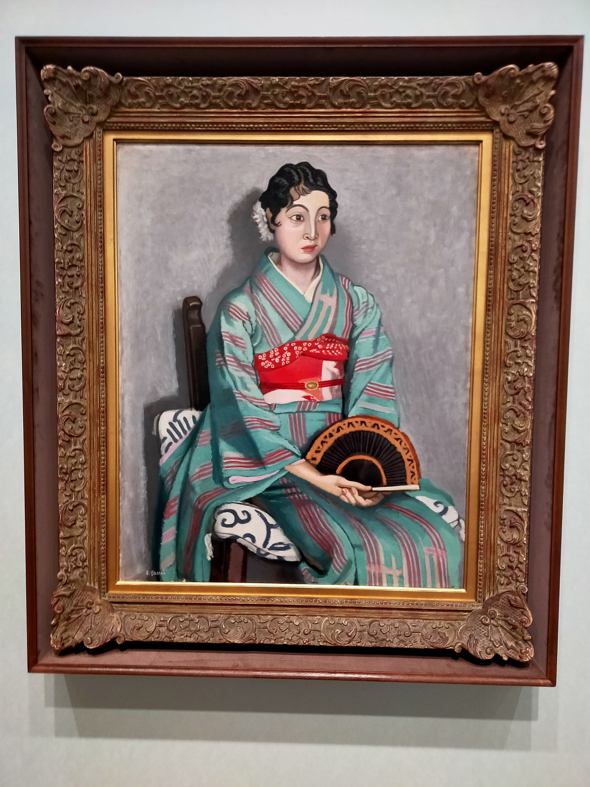
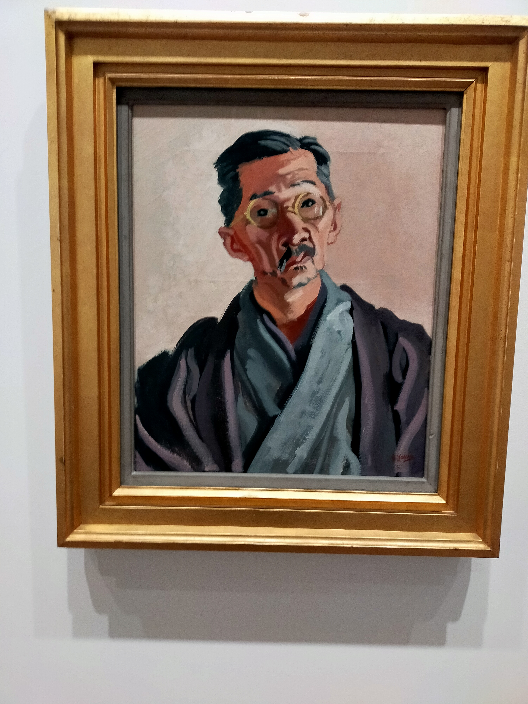
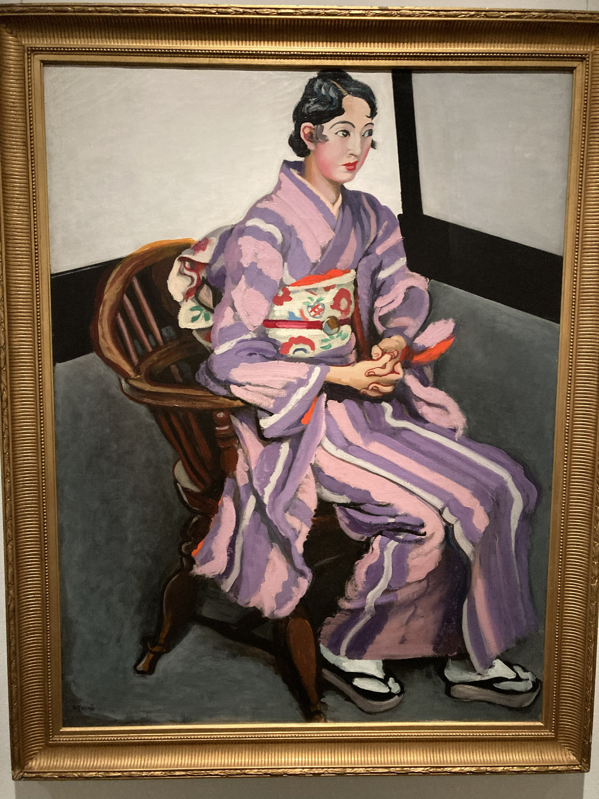
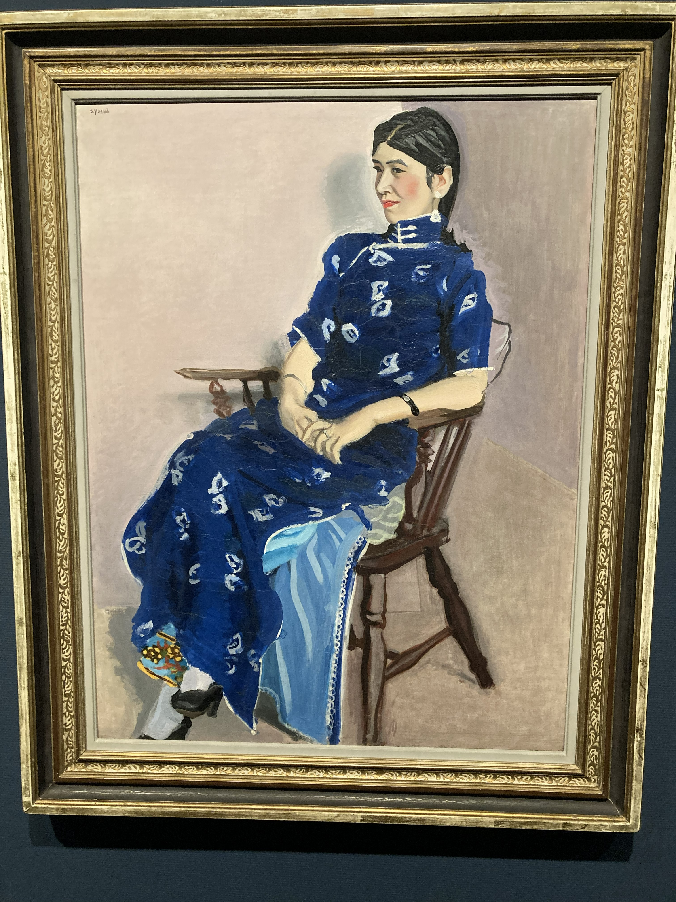
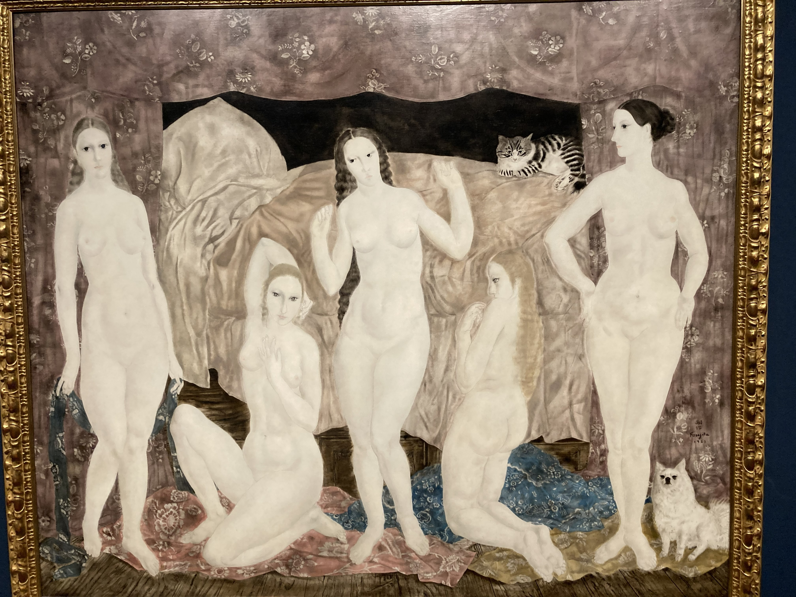
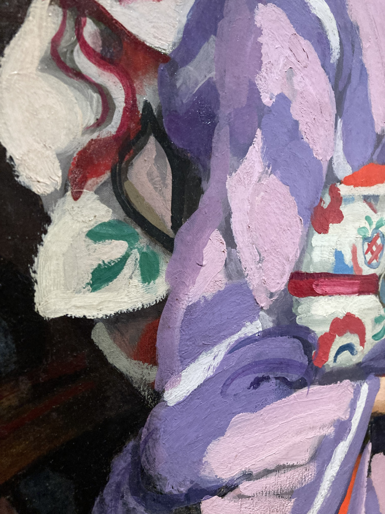
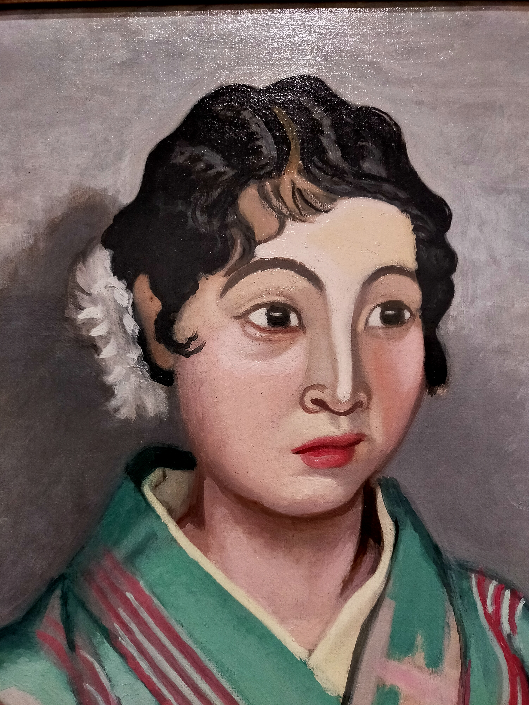
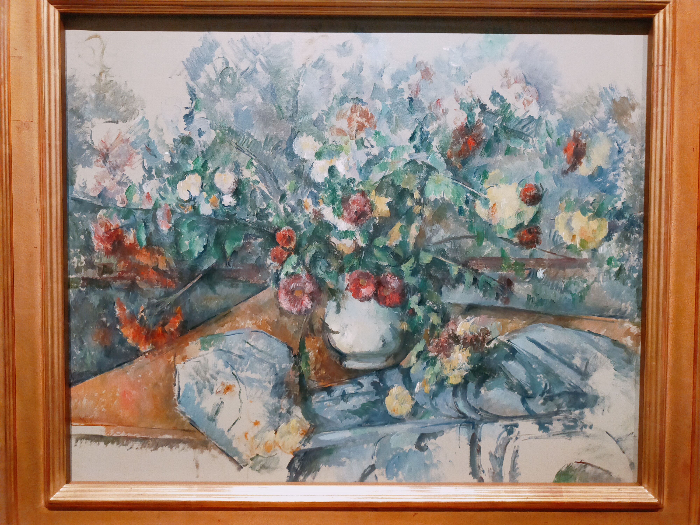
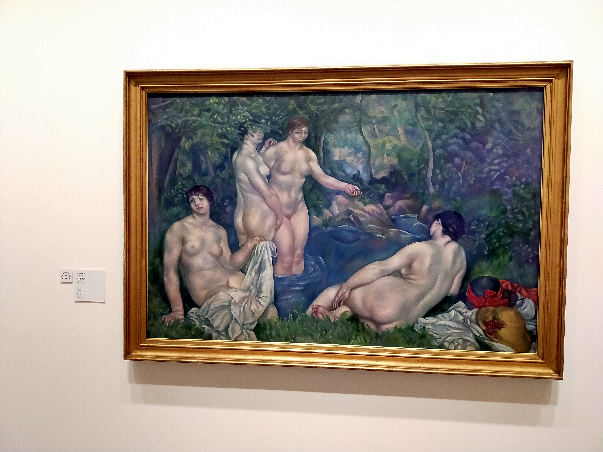

+++
title = "安井様式"
date = 2026-10-22T00:00:00+09:00
draft = false
tags = ["船", "仕事", "油絵"]
+++
今日は朝、全体掃除がありました。
また、それに気付かずに部屋の前にサンダルをそのままにしてしまいました。
前日にタオルが置かれたりするので、それで気付かないといけなかったみたいです。
錨泊を除いて4日目、またその4日後に掃除をするサイクルが多いらしいです。
また、甲板に出る時は、網戸を開けたままにします。何故なら、外に人がいるかどうかを網戸の開閉で判断しているからです。
今日は、既に人がいる時に、甲板に出て、戻るときに戸を閉めるのを忘れてしまいました。
そこで、機関長の目に留まり、怒られました。
この前の、マイナスドライバーを渡されて、机の上に戻したら、ちゃんとなおせと怒られたのと同じです。
やっぱり、人が用意したものを、片づける時は自分がやるという行動は中々染みつきません。
ただ、このような行動を染みつけることが出来れば、人と一緒に暮らす時や自分の部屋でも、もう少し過ごしやすくできそうです。
なので、ゆっくりでも慣れていきたいです。

今日は、エンジンの潤滑油を差すときに、足りなくなったらつぎ足すためのバルブがある事を知りました。
また、FO系統を少し見て、補機と停泊用発電機に向かう系統はかんたんにわかりました。
ただ、主機の系統ではエンジンにどのようにFOが入っていくのかよくわからないので、どっちが出口か、入口なのかわかりませんでした。
今度絵でもかいて、一つ一つ聞いていきたいです。

昨日はFO系統の切り替えの記載をミスしてしまっていたようです。今日は、正しく記載できてよかったです。
昨日は、結構気持ちが落ち込みましたが、予想通り今日は楽に過ごすことが出来ました。自分のメンタルや体調について深く知って、見通しを持って行動できるようになりたいです。

美術の話をもっとしろと愛読者から連絡がきたのですが、私はこのブログのテーマを「リアル」と決めています。
画集の画像や、一つの美術館所蔵の絵だけのブログは書きたくないんです。
というより、実際にいくつもの施設に足を運んで見た絵について書きたいのです。
だから、今日は代表作をしっかり見ている安井曾太郎について書こうと思います。
特別好きなわけではないのですが、美術館で出会えることが多く、縁がある作家です。
1929年頃「安井様式」という独特なスタイルを肖像画にて確立して人気を集めました。
まず、私が見た「安井様式」の代表作は4つです。それらを紹介します。
ただ、安井作品のタイトルは「座像」、「婦人座像」などシンプルなものばかりで、私も覚えていません。
そのため、割愛させていただきました。  

①大学4年生の1月にアーティゾン美術館石橋財団コレクション選で見たものです。同美術館のモネ展にも行ったのですが、比較して10分の1以下の来客だった覚えがあります。 

②同じくです。この絵は縮小バージョンで同じ対象を描いた大型作品もあるそうです。

③近海船前の4月に国立京都近代美術館のコレクション展で見たものです。  

④近海船前の5月に国立東京近代美術館のコレクション展で見たものです。  
紹介する絵画の選定基準について説明します。
アーティゾン美術館の展示では2作品以外にも肖像画がありましたが、優れていたのはこの2作品でした。
国立京都近代美術館には、③だけでなく、もう1枚肖像画がありましたが「安井様式」と言える年代の作品ではありませんでした。
④の作品はこの美術館が初めて購入した作品と歴史年表に書いてあり有名作品なのですが、
「安井様式」の良さがあまり出ているとは思えない作品です。隣にあった藤田嗣治の絵の方がよかったです。

なので、今回は④の作品については、紹介しません。

安井様式の絵の第一印象は、色遣いに爽快感があって、絵全体に上品さがあってステキ。でした。
しかし、近くで見た時の印象は、気持ち悪い。です。
肖像画なのに芋虫を組み合わせて出来ているかのような、躍動感があるのです。
③の絵のアップを見ていくとよく分かります。

グレーズをしているのではなく、大胆な筆致で絵具を乗せていき、一つの服という
連続した面でもその勢いを殺すことなく、色ごとに継ぎはぎで書いています。
だから、写実のようでそうではない、独特の生命感が絵に宿っています。
②の作品も、顔や服に太めの筆の勢いを残したまま全体としてみると老父になっていいます。
しかし、全体としてみるとそれらが集まって、人の形になっています。
この二つの作品からわかるように、独立した筆の流れを継ぎはぎのように重ねて一つの形にするのが「安井様式」の特徴です。
私は、この特徴からうまれる生命感がちょっとエグく感じるので、そこまで好きになれないです。
次に、①の作品を見てみましょう。

この絵は顔の表現がキモです。鼻の左側や下は影を面で表現しています。
それに対し、鼻の右側の影やあごのラインは輪郭線で大胆に描いています。
一つの絵の中で、面と線、影の描き方をミックスさせて書いています。
そのため、先の筆遣いの特徴と同様に単なる写実を超えた面白さを感じました。
当初感じた気持ち悪さは、この独特な描き方によるものだろうと思っています。
 　　 
まとめると、「安井様式」は単に写実、単に陰影を面で描いていくということだけではなく、複数の視点を組み合わせたり、輪郭線を描くなど平面的な要素が多分に入っています。
しかし、全体としてみると対象を丁寧に描くことが出来ているのです。そのため、高度なバランス感覚で成り立っている絵画だとわかります。  
紹介したように「安井様式」には視点の継ぎはぎや、影を線で描く。という要素が見られます。そこで、言及しなければならない作家がいます。
この要素を持つ同時代の作家を思い浮かべてみてください。それは、ずばり19世紀終わりごろに活躍したセザンヌです。
セザンヌはフランスの画家で、立体を平面的に書いたり、輪郭線を使って影を書いたことで知られています。
画風について安井曾太郎の絵とかなり共通点があります。

この絵はセザンヌが20世紀初頭に書いた絵になります。
ちなみに、この絵は近代美術の中でもトップクラスに好きな作品です。花・花瓶・机が背景と一体化した奥行きの無い描写が為されています。
それは置いておいて、安井はフランス留学経験があり、セザンヌを研究し26歳の頃には、セザンヌの有名絵画[「bather」]()そのままのかなり大きな絵も描いていたようです。
この絵も奥行き無いですよね。そのため、「安井様式」とセザンヌ絵画は要素を共有しているだけではなく、
セザンヌから直接的に学ぼうという気持ちが安井にあったようです。

私は好きでもない作家から影響を受けることはないのですが、美術への取り組み方については学ぶことが多いです。安井曾太郎の絵も同じです。
というのも、絵の変遷や画風について考えると、その重みが伝わってくるのです。
まず、若かりし頃の安井の絵は間違いなくセザンヌに傾倒した絵でした。
次に、セザンヌの要素をベースにしながらも、その後も絵を書き続けて爽快感のある色彩、独特の太い筆致、和装のモデルなど新しい要素を
積み上げて独自のバランス感覚で「安井様式」を確立しました。私もその独創性は理解できました。
しかし、それはすぐに作り出せたものではなかったのです。
というのも、①の絵画が「安井様式」のはじまりとされていますが、紹介した留学時のもろセザンヌ絵画から数えると15年後に発表されたものです。
私が高度なバランス感覚で成り立っていると感じた通り、「安井様式」は長い修業期間を経てはじめて到達した境地だったのです。
その期間について考えると、絵を書き続けていてもそれだけかかるのかと、気が遠くなりました。
何故なら、私は15年というスパンで物事を考えたことが無いからです。しかし、こうやって絵が残っているなら15年の努力なんて屁でもないなとも同時に思います。
その重みを受け止めながら、私も真の独創性にたどり着くには毎日、地道に積み重ねていくしかないなと思いました。

