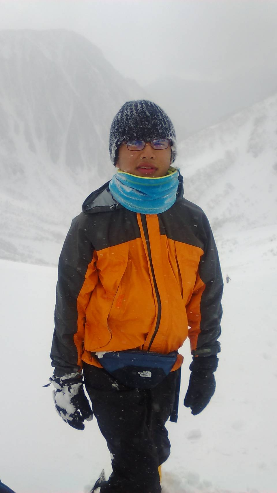
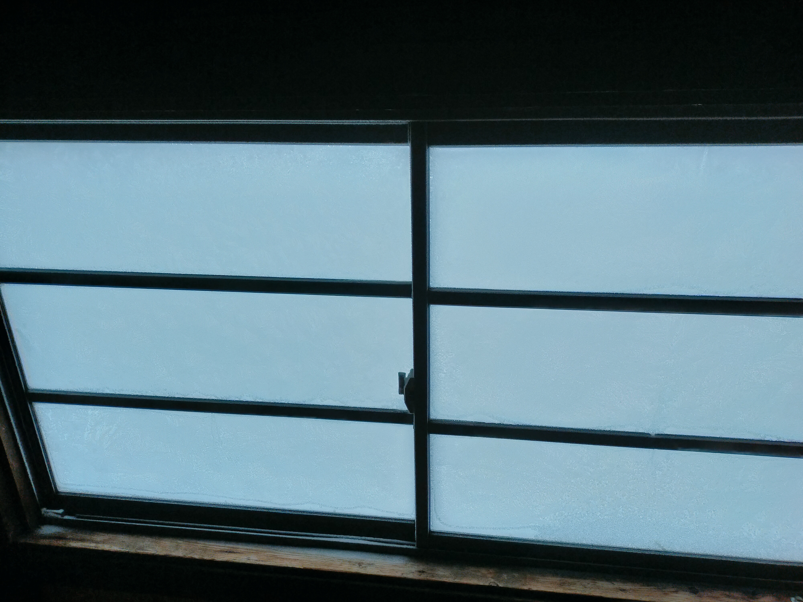
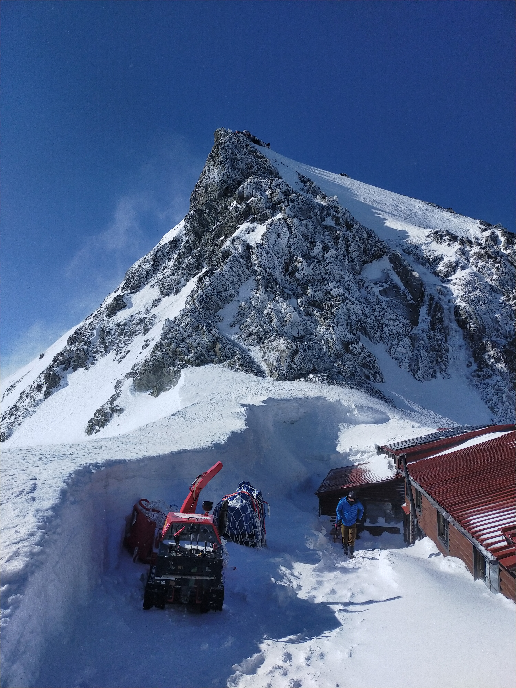

+++
title = "山"
date = 2026-10-30T00:00:00+09:00
draft = false
tags = ["船", "仕事", "自然"]
+++
今日は、空調機を冷房から暖房に切り替えました。やり方を教わったので、記します。
- 空調機をファン設定にする
- コントローラーの選択ボタンを長押しして、CからHに切り替える
- 自動でオンになる温度を20.5℃、オフになる温度を21.5℃にする。
- 決定ボタンを押す。
- 空調機本体についているボタンを操作してファン設定からヒーターの設定に切り替える。
- ゲージを確認する。

つぎに、あまりにも暇すぎて指の間接を数えだしたりしていたら、見かねた機関長が真鍮磨きやるぞと言って、やり方を教えてもらいました。
- オレンジ色のハンドパッド#3000とウエスを準備する。
- ピカールを適量ハンドパッドにつける。
- 真鍮の部品にピカールをつける。
- ウエスで磨く。
  
丁寧にやると一つの部品に10分20分とかかるので、1時間くらい簡単に時間を潰すことが出来ました。
少しずつ進めていきたいです。

今日は、全体的に主体性がない一日でした。
というのも、何かをしたいという気持ちが全然わかず、ボケーとしていたのです。
なので、それに関連して、自分からすすんでしたことではないけど、印象深かった経験を話します。  
**北アルプスで2回死にかけたことがある**  
父は、山キチガイで、暴れ者です。
たとえば、母が出産する際にも、山で安産祈願をすると言って、出産に立ち会わなかったので、母はそれが心の傷になってしまったそうです。
父の山への情熱の矛先は私にも及び、2度死にかけることになるのです。

まずは、私が中学2年生の頃です。
GWに槍ヶ岳に連れていかれました。私は登山に関するトレーニングを一切受けたことがありませんでした。
GWの槍ヶ岳の難易度は、国内の山の中で最高です。2泊3日で行くような場所です。そこに、私は父と二人で行くことになりました。
はじめてアイゼンを付けて山登りをしたのが槍ヶ岳でした。
槍ヶ岳山荘に行ったところで、登頂アタックはピッケル技術なしでは厳しいと判断し、一泊して下山しました。
下るのも下るので大変で、風速15メートルの暴風が吹き荒れ一度ホワイトアウト・視界約2メートルの状況で、コースを外れてしまいました。
一度、コンパスと地図を用意して下山の向きを確認してからは、父とくっついて少しずつ進んでなんとか降りることが出来ました。
覚えている事は、槍ヶ岳に上る際に、うずくまっている人と、地面に埋まっている人がいたことです。
後に知ったニュースですが、うずくまっていた人や埋まっていた人は遭難者で、死人だったようです。
ただ、これはそこまで嫌な思い出にはなりませんでした。

強引なやり方の父親に嫌気がさし、大学2年生の1月から疎遠にしていたのですが、「もう無理がきかなくなってしまいました。会いたいです。」との手紙が届いたのと、「親孝行は親が元気なうちに」とアドバイスをくれた人の影響、
大学を卒業して心理的な余裕ができたことなどで、大学4年生の3月卒業式前に父と連絡を取りました。
父はいつも山に一緒に行きたいと言っていたので、「山につき合うよ」と大学の卒業式で話しました。
すると、GWに連れていかれたのは、槍ヶ岳と同じく北アルプスに位置する奥穂高岳でした。「槍ヶ岳よりは厳しくない」とのふれこみで行きましたが、実際は槍ヶ岳よりピンチに陥りました。
横尾山荘から出て、涸沢につくまで何度もアイゼンが外れました。中学2年生の頃使っていたものと同じものでしたが、固定具の劣化が進んでいたようです。
涸沢から13時に出発し、奥穂高岳山荘への直登ルートを選択しました。
これが最悪でした。私は、[涸沢小屋の表示](map_karasawa.jpg)を見てザイティングラードの右じゃねぇの？と何度も言ったのですが、父は「いつもは左なんだ」と突っぱねました。
すると、そこはトレイルのない、雪崩頻発のルートだったのです。非圧雪で全然進めない、アイゼンは外れる、天候は雹が打ち付ける荒天。かなり厳しい条件でした。
1時間ほど登るたびに、雪で白んだ景色に、石垣やポールのような幻覚が見え、いつまでたっても奥穂高岳山荘にはたどり着けません。
ザイティングラードの中を進もうと試みて、結局諦めて元に戻り40分くらい浪費した場面では、私はもう終わったなと思っていました。
それでも、上り続けているといっそう斜面が急になり、休める場所もなくなり私では歯が立たなくなりました。そこで、父が先頭に立ち道を固めます。その後を私は慣れないピッケルを突き刺しながら、四つん這いで進んでいきました。
体力的にはまだ余裕があったのですが、息が切れて頭が痛かったことを覚えています。
最終的に山荘ついたのは、18時ちょうど。山荘についたときには、空が真っ赤になりアイゼンが片方なくなっていました。アイゼンがなくして斜面は登れませんから、ほんとうにギリギリでアイゼンをロストしたことになります。
山荘に入り、落ち着いたころにはどっと走馬灯のような記憶があふれ出て、デービゴを飲んで寝たことを覚えています。

翌朝父は奥穂高岳に登頂して、知人の骨を散骨したかったようですが、「昨日運よく生き残っただけで今日は死ぬ」と私は拒否しました。そのころ、前日の荒天中にジャンダルムに挑戦して死亡した人がヘリで回収されているのが見えました。
それだけで終わればよかったのですが、また最悪でした。父は初日に上高地から新宿行きのバスを買っていたのですが、下山中全然間に合わないペースで歩いていました。
登山靴が合わないものを使い続けていたからです。
そのため、父と横尾山荘あたりで、別れ私だけがバスに乗る事にしました。なので、横尾山荘から走って上高地バスセンターまで帰ったのです。
装備不足、体力不足、情報不足の状態で若いころのように高山に上り続け、文句をいうと、「じゃあ自分で全部計画しろ」などと言ってくるため、最悪の思い出になりました。

のちに父は夏山でもう一度ジャンダルムに挑戦し、滑落して救助されたようです。

