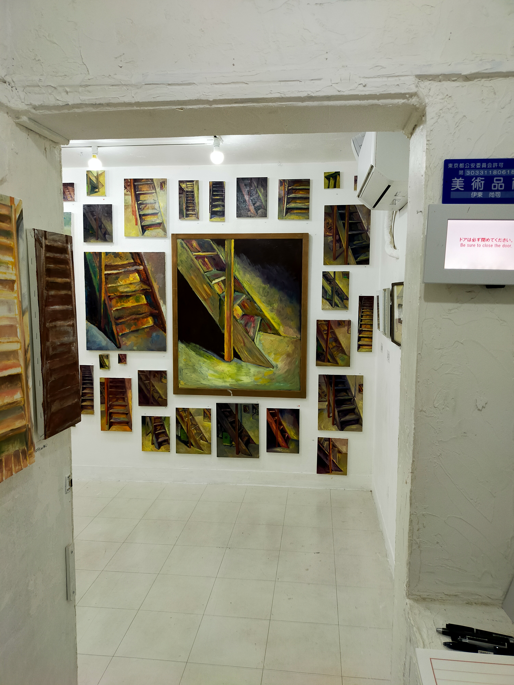
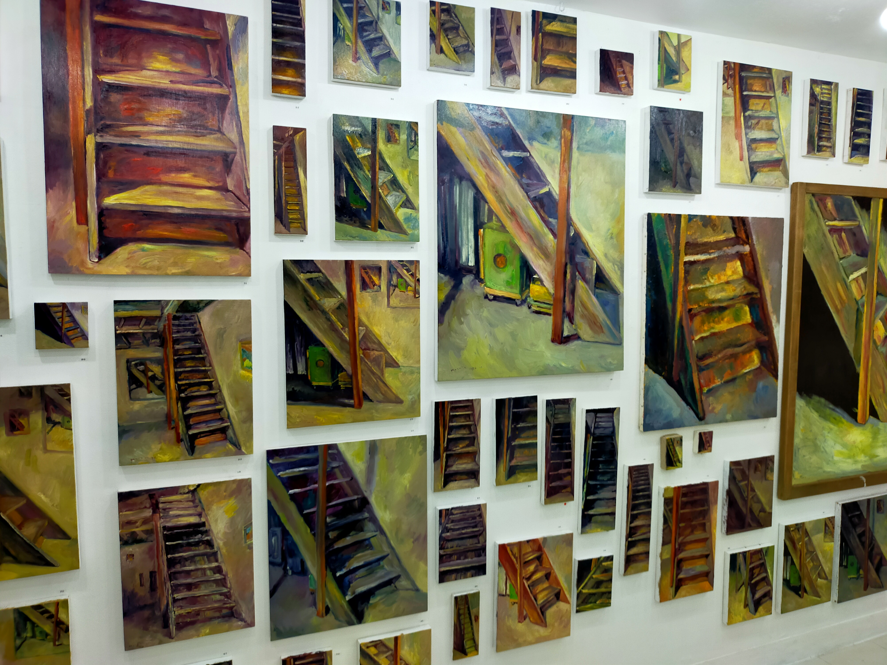
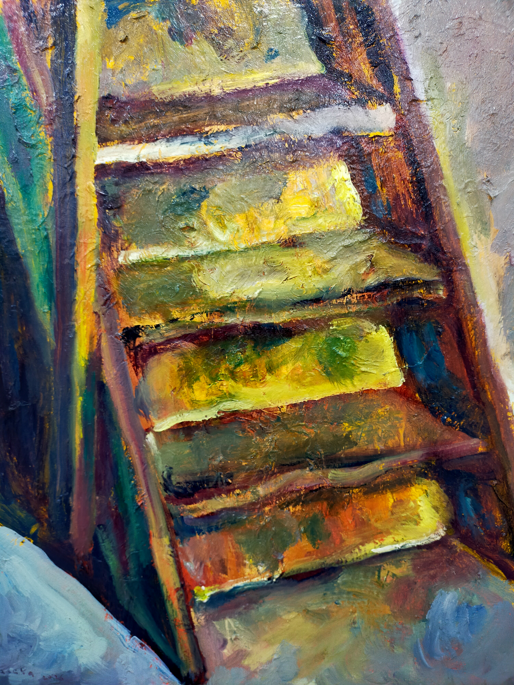
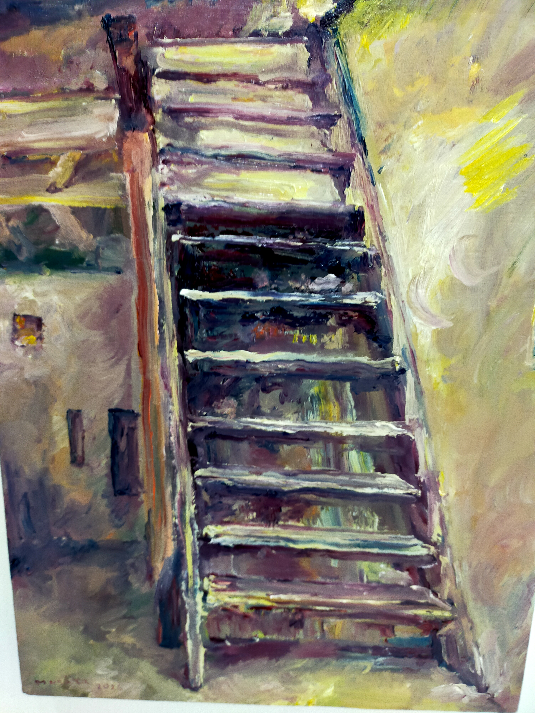
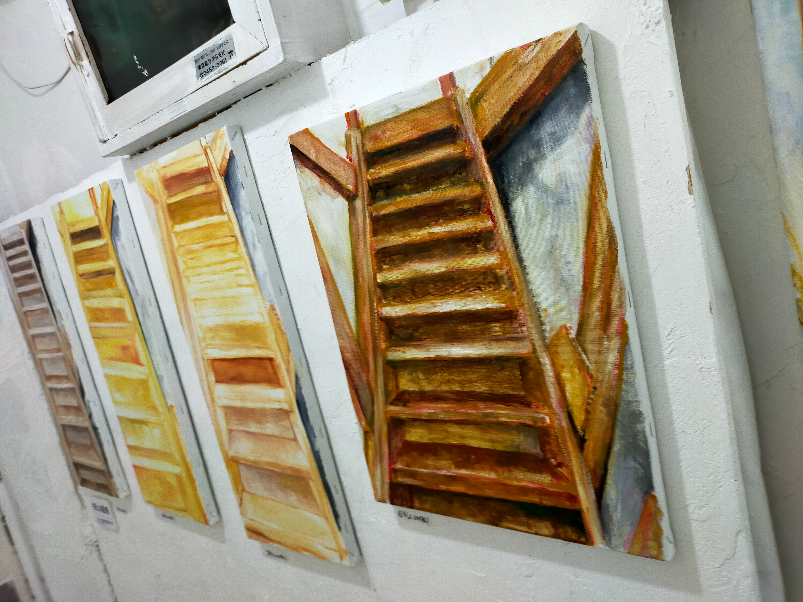
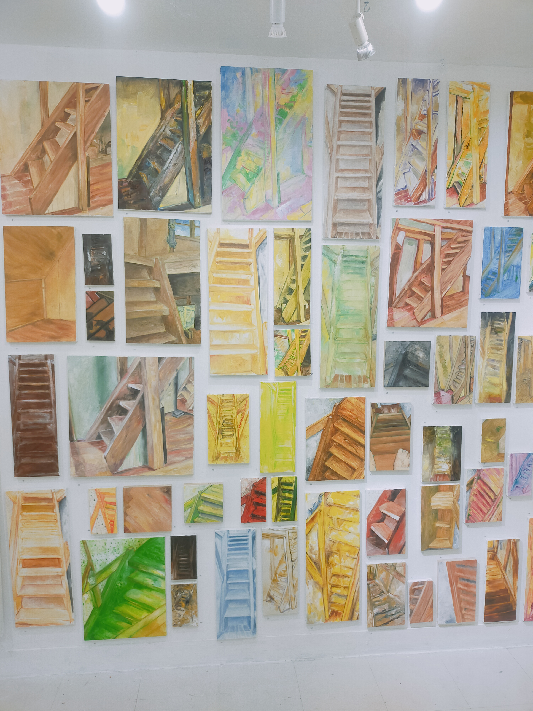
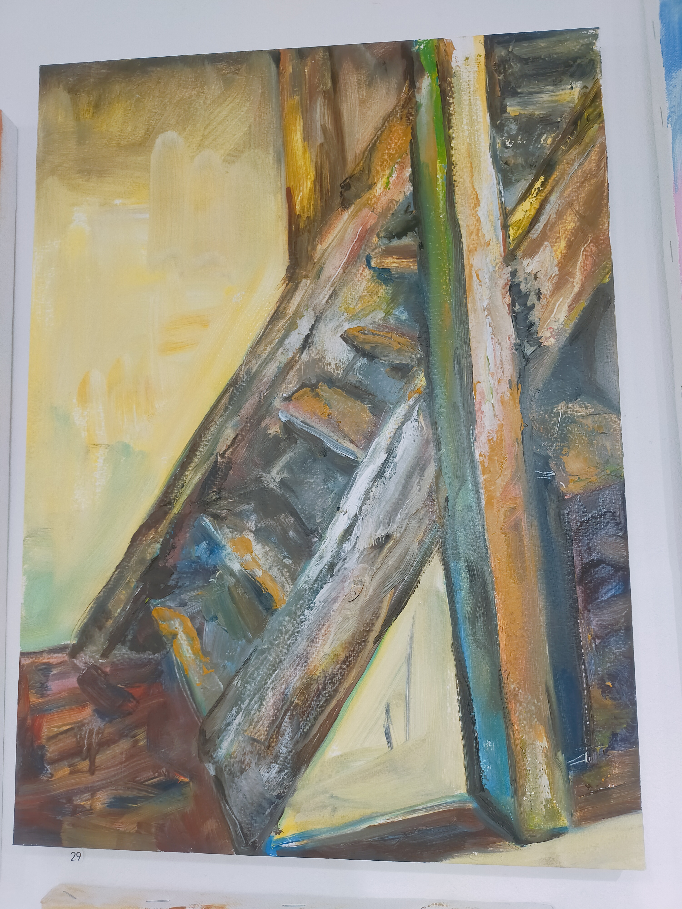

+++
title = "画家王と階段派"
date = 2026-11-01T00:00:00+09:00
draft = false
tags = ["船", "仕事","キャリア", "美術"]
+++
今日も、ワッチでした。次航海から一人でワッチを任せてもらえるそうです。「わからなかった、間違えました、では済まないから気を引き締めるように。」と言われました。
1か月でチュートリアルが終わったと言えるかもしれません。次の航海からは、また生活リズムが変わるので、いつもと変わるときは準備して挑みたいです。
真鍮磨きをしていたら、FOヒータというものを見つけました。船ではFOはA重油を用いているので、加熱は必要ないそうですが、一応ついているそうです。
ファーストとマグロ漁船の話をしていたら、「マグロ船なら未経験から5年で機関長になれる」という話にすごく食いついていました。

ファーストは、「水産高校と専攻科で5年間勉強して、官船で海技大で学生に教えているような先生に教わって、地道に積み重ねていったことで自分がある。」と言っていて、対照的なキャリアを面白がっていました。
遠洋マグロ漁船のキャリアアップはこうです。
- 未経験で員級B、つまり漁獲高に対しての取り代0.8からスタート。
- 1-2年たてば、機関員や甲板員として取り代1.0になり収入が1.25倍になる。
- 3年乗船履歴を積めば、口述試験を受けられるようになるので、海技免状を取得できる。免状を取ったのちは2等機関士などの役職をもって取り代1.2になる。
- 士官を1年やれば、1等機関士や機関長になれるので、1等機関士になれる。
- 次の航海で機関長が立場を譲れば最短で6年目から機関長になれる。機関長の取り代は1.6なので、最初の給料から倍近くになる。 
 
仮に、員級Bが500万円もらえる10か月航海の船に乗った場合を考えると、5年後には年収1000万円になれることになります。
言葉にしてみれば楽そうに思えますが、食いつくファーストを横目に私ははにかんでいました。というのも、マグロ船の1日は普通の感覚よりかなり長いからです。
たとえば、私が3週間近海船に乗った時は、最後の揚げ縄があと4時間ほどで終わる合図である、日の出が出てはじめて「操業があと少しで終わる」と思えました。
私が今乗っている船では、あと休みまで2週間ほどですが、「あとちょっと頑張れば終わる。」と思えています。あまりにも大きな違いです。
何故この違いが生まれるのかというと、マグロ船の揚げ縄が本当に長丁場だからです。まず3時間頑張る。いやいやな気持ちで5時間頑張る。限界を超えた部分で5時間頑張る。トラブルがあればそれ以上。しかも、明確な休憩時間はない。
これで毎日が構成されていて、密度が非常に高いのです。
言葉にしてみれば、5航海ですが、遠洋船の1年の操業数は約180回。すなわち、5航海というのは、限界を超えるような作業を900回乗り越えた後にある境地と言えるのです。
だから、机上の論で「夢あるな。」と言うファーストと温度差が生まれてしまいました。

しかし、自分が一番欲しいものは「マグロ船を経験して、人生の一部にした自分」であることは間違いないです。というのも、近海船では毎日ボスラッシュみたいな刺激的な日々を過ごせました。あれより面白いエピソードはありません。
そのうえ、筋力、精神力、経済力、器の大きさ、社会性が育つと確信しました。
そして、創作にも役に立つと思っています。何故なら、毎日の職人仕事によって仕事への忍耐力が育つと考えているからです。

この、過酷な職人仕事が創作に役に立つという発想は、職人仕事でキャリアを形成した画家、吉岡雅哉を学ぶと間違っていないなと思えます。
これが今日の小噺になります。
吉岡雅哉さんの絵の凄さを理解するには、まず笹山直規さんを知ると分かりやすいです。
笹山さんはもともとグロテスクな絵を専門に描く死体画家として名をあげたイロモノの画家でした。
しかし、40歳を過ぎて画家宣言をして「画家王」を名乗り、地味な静物画を描くようになり、対象の新奇性にとらわれない美しさを追究しだしていました。

私もこの絵や美術に対する純粋な姿勢に感銘を受けてマグロ漁船前の1月に、個展「up hill」を見に行きました。
ワサビやアイスクリーム、卵、靴、近所の建物などありふれたモチーフを丁寧に絵画にするという方向性がステキでした。  
**審美眼の画家もうならせた階段画**  
また、笹山さんの他の画家への審美眼は共感できるものがありました。
[彼の評価する同時代の画家についての投稿](https://x.com/StudioNega/status/1999233179455201567)
では10人以上あげられていましたが、私にとってどの画家も初めて聞く名前なのにもかかわらず、調べてみると独自世界を高めて進化しているような絵を書く人ばかりでした。好みも自分と結構合うと思いました。
[俺の画家ライバルは井澤由花子だけ、後は全員ザコ。](https://x.com/StudioNega/status/1994622918475878842)
という投稿で紹介されていた井澤由花子もスゲーなと単純に思いました。とにかく、笹山さんは高い感受性で他人の作品の可能性に敏感な人でした。
そんな笹山さんが、Xでの絡みで出会ってしまった本当にヤバい絵がありました。
それが、吉岡雅哉の階段画です。

この階段の絵を見てすぐ、笹山は吉岡を真似して自宅の階段を書くようになりました。そして、階段の絵を書く画家を4人集めた「階段派」というグループを作り吉岡を「マスター」として派の頂点に置いたのです。
さらに、階段派展というグループ展まで企画したのです。
笹山は階段画の可能性を次のように語りました。
「階段というのは身の回りにありふれているものにも関わらず、西洋絵画の巨匠たちが地味すぎて目を付けなかった。ここに、洋画を我々が更新できる余地がある。」と語り、階段派の新規性をといたのです。
私もその意見に賛同し、[油彩で階段を書いてみました。（未完）](kaidan_saya.jpg)とにかく、可能性を感じさせる1枚の絵だったのです。

笹山さんの審美眼は正しく、グループ展での吉岡さんの階段画は予想の数段上を行きました。それはマグロ漁船前の4月のことでした。

なんと、制作した大量の階段画を壁一面にしきつめるような展示をしたうえ、その一つ一つが、美術館にあってもおかしくないほどの個性と技量をほこる作品だったのです。
私も、この展示を実際に見て魔法のような感覚に陥りました。まず、壁全体の絵画が目に入ります。そこから少しずつ個々の絵に注目し、その奥深さに感銘をうけます。その繰り返しで2時間ほど滞在していました。
この展示は圧倒的で、グループ展とは名ばかりで吉岡さんの独壇場だったのです。
比較すると、グループ展での笹山さんの絵の存在感は小さいものでした。

そこで、[笹山さんはこの格差を前にして、吉岡さんと袂を分かち、自身が立ち上げた階段派を脱退します。](https://x.com/StudioNega/status/2070225924289892765/photo/1)
そこで、自身も壁階段を再現する個展に挑むことになりました。
それが、マグロ漁船後の7月にあった個展「Up and Down」です。

笹山さんは油彩が得意な画家ではなかったのですが、これを機にアラプリマで油彩を100点持ち込んだようです。
私の感想としては、笹山さんが絵の鍛錬をしているという心意気は伝わってきて、一つ一つの絵の面白さも分かりました。しかし、吉岡さんの壁階段のような静謐さや神秘さ、えげつなさは感じられませんでした。
階段を絵にする。という分野においては、吉岡さんはまさに、はまり役でした。モネにとっての睡蓮というレベルで、笹山さんが敵う相手ではなかったのです。
そこで、何故吉岡さんの壁階段が際立っているのかを考えざるを無くなりました。
私が考えるに、吉岡さんの階段画が先んじている部分は次の通りです。
- 元宮大工という経歴があり、対象としている階段もアトリエの中にある自ら手掛けたものであること。
- 巨匠の模写などをしていた時期が長く、絵画の基礎的体力が違った。
- 「大工仕事でくたくたになるように、絵を書いてそこまで至りたい。」と繰り返し発言しており、職人仕事の延長線として制作に挑んでいたこと。

モネが睡蓮にこだわるようになったのは、自身の庭を作り、そこに睡蓮を植えてからというのは有名な話です。一つ目の要素に関しても同様に、吉岡さんが階段を描いたのも偶然ではなく、自ら手掛けた愛着のある対象だったからです。
二つ目の要素は、吉岡さんは、ラファエロやクールベ、レンブラントなどの絵画の模写を沢山しており、絵画的な絵についての基礎がありました。笹山さんも個展「Up and Down」ののちにベラスケスの模写をしています。
三つ目の要素について、大工という繰り返しの職人仕事が、階段という地味な対象物を繰り返し書くという苦行を可能にさせました。笹山さんも肉体労働従事者でしたが、職人仕事ではありませんでした。

私がマグロ漁船で感じたものはとくに三つの目の要素です。近海船での仕事は毎日同じでした。投縄して揚縄をする。毎日それだけの繰り返しです。そこで働くなか、飽きるという感情や理屈を超えて手を動かし続けるという概念を学びました。
その心意気を持って創作に励めば、「繰り返しで、単調で面倒だからやめておこう」というような感情を捨てて取り組めるなと思ったのです。（私は、その領域に達する前に眠れなさ過ぎて近海船をやめてしまったのですが。。。だから階段の絵一個も完成させられないんです。）
つまり、繰り返しの境地に至れば、他の人がやろうと思わない作業や多くの作業が出来るようになって、他の作家と差を付けられると思ったのです。
また、その境地に至れば、吉岡さんが笹山さんに多大な影響を与えたように、世界を変えるような創作にたどり着く一助になるはずです。世界を変えれたら、超がつくほど面白いはずです。
だから、私は作家になりたいと同時に、他の職人仕事で鍛えてパワープレイのステージに至りたいのです。

