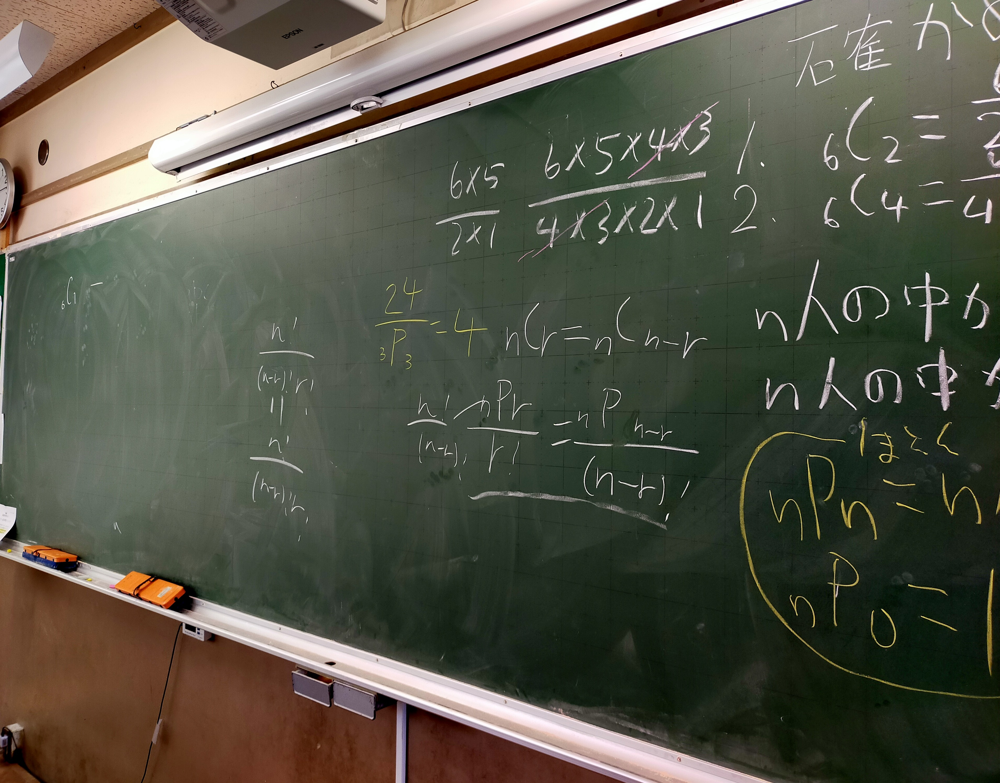

+++
title = "いわゆる「抜け」がある人のメリット"
date = 2026-11-03T00:00:00+09:00
draft = false
tags = ["船", "仕事","障害","キャリア", "教育"]
+++
今日は朝から補機の補修を見学しました。
昨日の午後3時から水漏れがしていたようで、朝に補修をしていました。
まず、カッター等で元からついている補修具を除去します。次に、アーロンテープという水圧に耐性があるテープで巻きます。その後、ゴムテープで巻いて補強します。
それで完成です。今回は、液状のゴム補修具、Shoe GOOを最初に使っていましたが、効果は不明でした。
今日は船長命令で移動するものの固定などが指示されていました。一日を通して揺れていましたが、そこまで激しくはありませんでした。
そろそろ、稚内につくので、明日で先輩と一緒にワッチを取るのは最後かもしれません。
今日は、大学４年生の５月に行った教育実習の話をしたら、大ウケでした。何故なら、私が教育実習に行った筑波大学附属高等学校の実習生への扱いが、結構酷かったからです。
というのも、私は第一回の授業をある程度成功します。数日後に次の授業をしようとしたら、PCがプロジェクターにつながりません。
準備していたスライドが使えないまま、学習指導案の記憶を頼りに板書をして授業を執り行い、何とか切り抜けました。
その後、指導教員から「実習生史上最悪の授業だった」「打合せしていた部分が全然入ってないじゃないか」と、授業後の振り返りでこっぴどく怒られました。
というのも、スライドを見ながら全体の流れを思い出そうとしていたので、とっさに板書に切り替えたら、説明に抜けが出てしまったのです。
この一件があり、授業前に早めに登校して動作確認をするようになったり、パワポに頼らずに説明できるようになるまで練習するようになりました。
つまり、事前準備への気合が入るようになりました。そのため、ハプニングについて良い面はあったのですが、その後8回授業して、一度も接続不良になりませんでした。となると、このハプニングは必然だったのかもしれないと思いました。
この話をすると、「それは先生が仕組んだね」と先輩に言われ、「そういうシゴキ方があるんだな」と大ウケでした。

そこで今日は、筑波大学付属高等学校での教育実習で学んだことを思い出したので、それを書いておこうと思います。
実習最終日には[寄せ書きをもらいました](goodbye.jpg)
筑波大学付属高等学校での教育実習は、私の人生の一つのランドマークの一つになっています。何故なら、人生が大きく前進したと感じる発見が二つあったからです。
一つ目は、特につらかった高校１年生の時に感じていた鬱憤や知りたかったことを、現役の高校１年生に伝えることが出来たことです。何を伝えたのかは、また記事にします。
二つ目は、自分にとって「抜け」がある部分について、全く別のとらえ方をできるようになったことです。
さらに、のちの人生最大の逆襲に通じる布石もあったのですが、今日は二つ目の話を書きたいと思います。

教育実習では、場合の数を初学者に教えました。自分は問題が解けるから教えられる。などと甘く見ていましたが、教科指導の専門家の評価を直で受けると、自分の理解にどれだけ穴があったのかわかりました。
たとえば、順列と組合せを数える時の記号PとCとについての理解です。私は、４つの異なる文字を３つ選んで並べる順列（4P3）は
４つの異なる文字の中から３つを選ぶ方法は４通りだから、それを並び替えて3!通り。だから、4P3=4C3×3!といった理解で、これを移項して、4C3=4P3/3!で、選び方(4C3)も数えられる。と考えていました。
まず、PとCを考えて、どのような関係があるか見る方法です。これは分かっていました。
しかし、教科書の普通の記載では、4つの異なる文字の中から３つを選ぶ選び方(4C3)は、４つの異なる文字の中から３つを並べる順列(4P3)をまず数え、同じ選び方になっている順列を一つと数えればいいから、4C3=4P3/3!と記載されています。
というのも、Pを操作して、Cに至るという方向性の考え方です。
私は教育実習ではじめてこの考え方を知ったうえ、全く理解できませんでした。なんというか、複数のものを同じに見なすという操作が難しいうえ、全部3!通りになることが自明には思えなかったのです。
そのため、授業当日までこの考え方を理解できず、授業をする際にはまるで落語のように、指導教員が打ち合わせで言った説明を一言一句そのまま喋りました。
しかし、その落語のような説明で、教室の私以外全員が理解しました。私が説明を一通りかたりおえて「ﾊｧﾊｧ...わかった？」と聞いたら、教室が静まり返りました。。。皆腑に落ちたということです。
　指導教員には、「色々な考え方・捉え方を出来る事が重要だから、君は数学科向いていないよ。」とはっきり言われました。

この出来事で自分の「抜け」を二つ考えることが出来ました。
まず、一つ目の「抜け」は、大学受験突破のための勉強で解ければいいと深く考えていなかったので、この二通りの考え方をそもそも知らなかったことです。
つぎに、二つ目の「抜け」は、この考え方を知っても、理解することに凄く時間がかかったことです。高１の生徒が１時間でわかったことを、私は３週間かけて学びました。

一つ目は、私が他人の助けを欠いて勉強をすると、一つの考え方に頼って捉えてしまったり、重要な他の考え方を欠いて進んでしまうということです。つまり、「飛ばし」があるというタイプの穴があるのです。
他の人が目を通して難なく把握できる部分がそもそも知覚できていないという人間だったのです。。
二つ目は、私は、PとCの関係の様に、両方を仮定した時にその間の関係を考えるのはものすごく得意ですが、Pに対して操作をして、Cにする。という捉え方自体がものすごく苦手だったということです。
この考え方はPとCだけでなく、結構普遍的なものです。折り紙に応用して考えてみましょう。折り紙は、順序だてて折り目をつけて最終段階で完成するというのが基本ですが、完成までにつける折り目を全て最初につけてから、畳むように完成させるという方法もあります。
私は、あるものを変化させていって、最終的に別のものにする。という考え方に至りにくく、あるものと別のものとを両方みて、その間の関係性をみる。という方が圧倒的に分かりやすいのです。
（障害科学の言葉で言うと、前者が継次処理、後者が同時処理という風に言います。）
つまり、私はある発想そのものに至りにくい「盲点」があるというタイプの穴がある人間だったのです。

私は、この２重の穴を生まれつき持っていることを何となく感じていましたが、数学科の指導という高度な「抜け目のなさ」を求められる場面で如実に感じたのでした。
この２重の穴は、いままでポジティブに捉えられたことがありませんでした。
学問を積み上げようとすると、「飛ばし」なく過去の研究を知っている必要が出てきて、困難が生じます。
苦手な考え方には想像力の限界があって、体で覚えるまで頑張るしかないです。
抜け目のなさを求められる場面では、自分はかなり困難があります。
一応補足すると、私は中学受験の時、一日１６時間効率よく勉強するというパワープレイを塾の先生に見てもらって、この２重の穴を埋め、入試を突破しました。
つまり、人の何倍もやりまくることによって、穴を埋めていたのです。そのぶん、「抜け」がない人には一生かかっても追いつけないな。と考えていました。

しかし、教育実習で私のことについて生徒に説明する機会が幾度となくありました。そこで、その穴が実は強みになっているかも。と思えたのです。
たとえば、私は大学の学部である障害科学類をなんとなくで決めたのですが、大学在学中に学んだ障害学でもって自分の高校時代の不適応を深く考えることが出来ました。
そして、なんとなくでインドネシア留学に行ったのですが、教育実習中にその話をすると生徒の食いつきがよくなり、授業でも反応を得られるようになりました。
マグロ漁船に興味を持った時もそうです。急に留学に行ったインドネシアが出てきました。
一つの考え方しかできなくても、強固な理論構築が出来なくても、一見関係なさそうな遠くのものを繋げることはできていたんです。
まず、遠くに行ってみる。対象を遠くにおいてみる。という経験を私がすると、今までの経験との関連性を早く見出すことが出来ていたんです。
インドネシア留学から順繰りに考えて行ったら、マグロ漁船にたどり着くことは不可能です。インドネシアという共通項は、同時に全く違うものを考える事で初めてたどりつける関係性だと考えています。
この遠いものと遠いものを結び付ける際に、より遠いもの同士を結び付けられることこそが、自分の「抜け」を活かす方法だ。と思ったんです。

本質的なたとえ話をします。同じ量のインクを用意します。そのとき、破線と太い線どっちが遠くまで線を引けるか考えてください。勿論破線ですよね。
偏った考え方、飛ばしがある見方を破線、抜け目のない考え方を太い線と考えてみてください。インクは努力や想像力です。
穴のある考え方・見方の方が、離れた事柄どうしの関連性をとらえやすいという事です。抜けの無い見方・考え方では、想像力の限界に陥る場面でも、関係性を捉えることが出来ます。
今まで、破線を何度も同じ場所に繰り返し引いて、実線にする。というような考え方ばかりをしてしまっていました。さきの、人の何倍もやりまくることで、考えの穴を埋めていたような話です。
しかし、より離れたものを繋ぐ。という考え方で見ると、破線は優れているんです。実線より同じ量のインクで長い線を弾けるからです。
私の性質は、遠くに行って新しい関係性を繋いでくることが本分なんだ。と思えるようになったのです。

この発想の転換は人生の進路選択に非常に役に立っています。とくに、「飛ばし」があるとだめな着実に進んでいる世界を避け、前人未踏の最前線に立ち世界を切り開く方向性でやれば、
一つの考え方・偏った方向性だったとしても、価値のある道しるべを作っていけるだろうと考えています。

