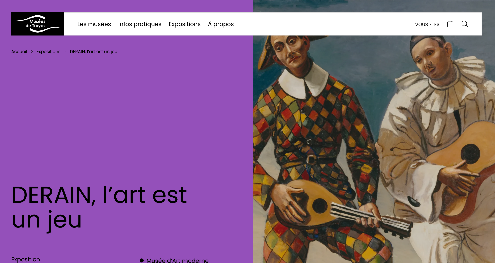

+++
title = "1か月頑張りました。"
date = 2026-11-05T00:00:00+09:00
draft = false
tags = ["船", "仕事"]
+++
今日は、入港日でした。
入港日前日は、夜飯が海鮮丼になります。しかし、口内炎が痛くて、あまり楽しめませんでした。また、生ものを10日航海の最後に出すので、あまり状態は良くないです。
朝、補機の起動をしましたが、前回始動空気の中間弁を開け過ぎと指導されたので、ちょっとしか開けなかったら、空気不足で始動失敗しました。
今度はもっとしっかり開けたいです。次に、調速ガバナを遠隔にするためには、しっかり押し込まないといけないのですが、それが結構できなくて、適当な回し具合にならないと押し込めないみたいです。
手続き自体は覚えていても、その加減が難しい。というたぐいの失敗です。
こういうことに昔は納得できませんでしたが、近海船で、ブランをキレイに畳んだり、カジキのツノをノコで落としたりをを繰り返して体で覚えるという事を経験したら、そんなことは思わなくなりました。
また、空調機フィルターの交換の場所を教えてもらいました。
空調室ふたつと、室内の空調室の前、2階の奥、司厨長室の前、2階の階段前　この位ですかね。
明日もう一度教えてもらおうと思います。
そして、初めて満額での給与明細をもらえました。もともと○○万円4000円と面接で言われていたのに、特別手当5000円がついて、○○万円9000円もらえました。また、食費や当直代で20000円くらいもらっているので、
思っていたより給料が20000円くらい高かったです。良かったです。
明日は、空調機の部品交換です。8時から海水サービスポンプを止めると書いてあったので、7時30頃に起きればいいだろうと思っています。

今日は、久しぶりにネットを楽しんでいます。11月の休みの間に行きたい場所を考えています。
[フランス、トロヤ近代美術館での企画展「アンドレ・ドラン　芸術はゲーム」](https://musees-troyes.com/expositions/derain-lart-est-un-jeu/)に行きたいです。
愛しのドランが200点以上みられるらしいです。今回の月給2か月分くらいかかりそうですが、行ってもいいかもしれないですね。ただ、場所がフランス！！

一応、[ブールデル美術館](https://www.bourdelle.paris.fr/visiter/expositions/andre-derain-lart-est-un-jeu) も含めれば来年の8月までやっているらしいです。
予定を確認しつつ、無理のない時期に行ってみたいです。

[愛知県、古川美術館での企画展「異邦人たちのパリ－ユトリロ/キスリング/レオナール・フジタ」](https://art-today.org/ex/babd4004f4.html)
これは、名前的にどんな展覧会か予想できますが、行けるならバスや新幹線乗ってでも行こうかなってレベルですね。

取り敢えず暇なら休み中に見ておこうと思う展覧会を並べておきます。  
[東京都、国立新美術館　ルーブル美術館ルネサンス展](https://www.nact.jp/exhibition_special/2026/louvre2026/)
まぁクラーナハは興味ありです。 
[東京都、東京都美術館　オルセー美術館所蔵いまを生きる歓び](https://www.tobikan.jp/exhibition/2026_orsay.html)
モーリスドニは好きだから、見る価値あるかもと思っています。  
[東京都、上野の森美術館　シンナシティ美術館展～アメリカに渡ったヨーロッパの至宝～](https://www.cincinnati-art2026.jp/exhibit.html)
ぱっと見でよさそうなのは無いけど、近いなら行こうかな。って感じです。  
[東京都、アーティゾン美術館　エトランゼたちー洋画家たちのヨーロッパ体験ー](https://www.artizon.museum/exhibition_sp/etranger2026/)
俺は黒田清輝が全く刺さらなくて、藤島武二は5％くらいしか刺さらないけれども、日本洋画のはじまりは知りたいです。まぁ優先度低めで行けたら行くで。

