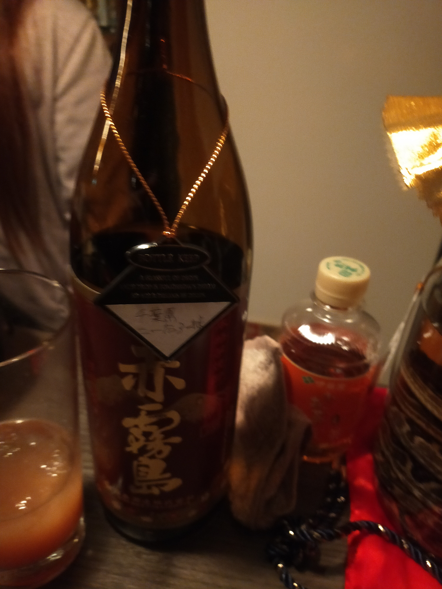

+++
title = "休みは休みじゃない"
date = 2026-11-06T00:00:00+09:00
draft = false
tags = ["船", "仕事"]
+++
今日は、朝から海水サービスポンプ系統を止めて、空調機の海水管の掃除をしました。
大体の手順を記します。
- トイレにバケツで清水をためておく
- 空調機のスイッチをオフにする
- 海水系統を止める
- ナイロン袋や洗面器、工具類を持って空調機室に行く
- ドレンを抜く
- ナイロン袋に海水が落ちるようにして、海水入口出口の管を外す
- 海水のストレーナのふたを取り外す
- 蓋についている亜鉛を取り外す
- 金属ブラシややすりを使ってサビを掃除する
- ペンキを塗って、亜鉛を交換する
- 海水のストレーナのなかにエアを送って、中のサビを除去する
- 空調機の蓋を外してポンプについているゴムを交換する
- グリスを補充して、出てきた古いグリスを捨てる
- 外したネジにグリスを塗る
- 外した管を元に戻す
- ビルジウエルにたまったサビをポンプで吸って捨てる
- 海水系統の管をバイパスにする。  
- 出したものを片付ける
  
今日はこの仕事を朝8時から、15時半ごろまでしていました。
その際に、大変だったことが二つありました。
それは、天候が大荒れだったことです。というのも、昼過ぎから稚内は強風と雹に見舞われて、気温は5度程度でした。
つぎに、機関場での仕事のリズムが分からなかったことです。3時間くらい働いたところで、11時30ごろから、監視室に入って、20分くらいおしゃべりしました。
「お昼食べますか。」と機関長が言って解散したので、休み時間がいつまでかわかりませんでした。この場合は、13時少し前から準備を始めればよかったようです。
お喋りも含めて1時間くらいかな。と思っていたら、全然違いました。漁船だと、昼食休憩なんてそこそこに、すぐ仕事をおわらして、すぐ寝る。というような方向性だったので、また違う世界でした。
明日は朝9時から仕事があるので頑張りたいです。

夜は、同僚のミナミマグロ漁をしていたおじいちゃんに、居酒屋浪漫と、スナックMに連れて行ってもらいました。
浪漫は、鳥串がおいしかったです。
スナックMについてはじめて、スナックに行きましたが、システムが分かってよかったです。
赤霧島を付けたので、18000円もとられていましたが、おじいちゃんはママとハグしていたのでよかったのでしょう。
おじいちゃんは、3年ぐらいしたら、色々な経験を積むために別の船に乗った方が良い。と言ってました。
また、「人生に後悔はない」と繰り返し言っていました。理由を聞くといろんな国の女性とセックスしたから。
言葉では言い表せない世界の荒波を経験したから。と言っていました。

マンデラ以前のケープは入港時に女性が1列に並んで、出迎えしてくれた。
ジャパンイズマネーはサイコーだった。と言っていました。
インドネシア人好きと言ったら、嫌な顔をされました。
インドネシア人と少ししか一緒にいないからそういうことを言えるんだ。と言われました。
まぁそんな夜でした。