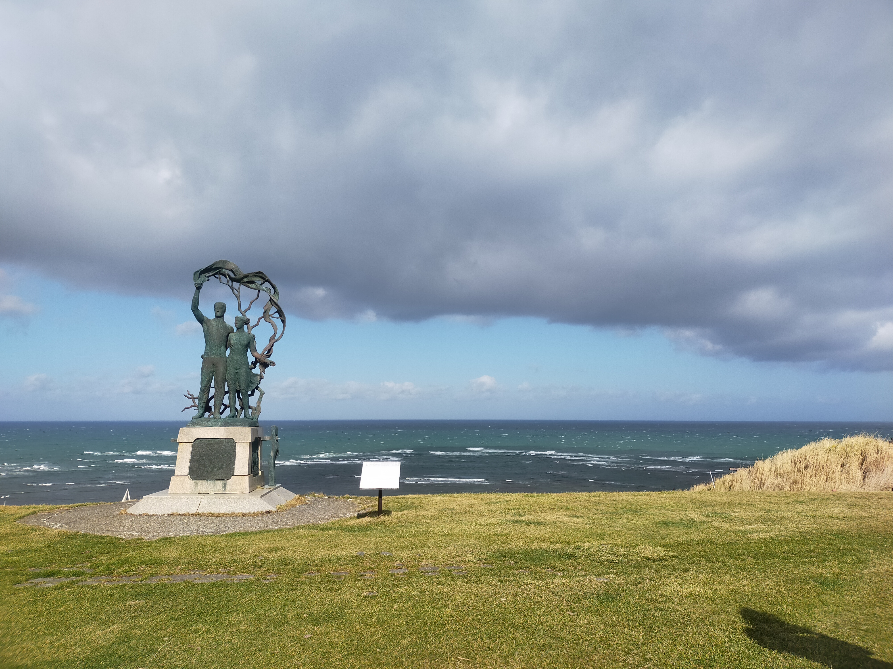

+++
title = "守銭奴Bと意固地なアキバオタクの音楽論の展開"
date = 2026-11-08T00:00:00+09:00
draft = false
tags = ["船", "仕事", "帳簿", "音楽"]
+++
今日は朝から風呂掃除とトイレ掃除でした
風呂掃除で、いつもと違う場所にマジックリンを戻したら、怒られました。
やっぱり、ぴったり元の場所に戻すのが難しいです。
トイレ掃除では、交換した手拭きタオルを使って最後に乾拭きすれば、きれいになると分かって次回はもう少ししっかりやりたいと思いました。

今日は、帳簿を付けたいと思います。財布を無くして、飯をケチって節約してたのが馬鹿らしくなったので、食費を多く使った気がします。

  
収入
- 食費 5500円

交通費  
- 二日目タクシー代 1900円
- 宗谷岬までの往復代 2940円
小計4840円
  
食費
- 初日昼ゼッテリア 960円
- 初日夜Victoria 2475円
- 2日目軽食レフボン 726円
- 2,3日目の弁当や酒 1524円
- その補充のトントロ 638円
- 4日目ポパイでのパスタ 1000円
- ミスタードナツ 552円  
小計7875円

仕込み
- 洗剤と保湿クリームと歯ブラシ 2854円
- ジュースとお菓子 2304円  
小計5158円  
娯楽
- セブンティーン、大人のための美術館ガイド、背景の書き方 4923円  
小計4923円  
累計
22796円使って、－17296円でした。  

仕込みは変わらないので、交通費や娯楽代で増えましたね。食費は、ビクトリアが高かっただけですね。
入港は月に、2－3日正直、このくらい使っても毎月○○万円以上貯金できるので、どうでもいい事が分かりました。

今日は、今残っている音楽プレイヤーのファイル情報をもとに、中学1年生の終わりから中3の中頃までに聞いていた音楽とその傾向について書きたいと思います。
中学1年生の頃は、東方をはじめとしたゲームミュージックを聞いており、
ゲームっぽい楽器を使っている事、ノれるアイコニックなメロディであること、ゲーム場面や登場人物に合致しているか、面白いリズムがあるか
などという価値を形作っていました。
しかし、その傾向も少しずつ広がり始めていました。
影響を受けて、聞いていた音楽は概ね3つの源流があります。
- クラッシュロワイヤルの影響
- アイドルマスターの影響
- Steamゲームや通っていたアキバの影響

まず、最初の一つ、当時はクラッシュロワイヤルにはまっていました。
クラッシュロワイヤルは人生の中で最もプレイしたスマホゲームと言っても過言ではないです。
当時はけんつめし、はるパパ、ドズル、きおきお、みかん坊や、クラテツ、Matatabiなど界隈が盛り上がっていたので好きでしたね。何よりも動画投稿者と同じ戦術をゲームの中ですぐ試せるのが好きでした。
その際に受け止めたのが、NCS Releaseと呼ばれるようなフリーのEDMミュージックです。なぜなら、その実況動画では、実況者の多くが[対戦のプレイ動画＋フリーEDMをBGMにしたスタイル](https://youtu.be/O_0yOlJMq9s)を採用していたからです。
聞いていたのは、[Wait For You](https://youtu.be/6alVa-dwBoY)や[OMFG-Hello](https://youtu.be/ih2xubMaZWI)、[Puzzle](https://youtu.be/TN_8D-79BZg)などです。
好意的に受け止めていたゲームと同時に摂取できていたという点で受け入れやすかったのもありますが、今まで考えていた価値にも合致することがあって嫌にならなかったと思っています。
というのも、EDMというのは主軸にする目標がダンスという事で、ゲームミュージックとは方向性が異なります。しかし、シンセサイザーを使いこなすことは同じです。なので、「ゲームっぽい楽器を上手く使っているか」という同じ価値観を用いて悪く無いものと考えていたのだろうと思います。
また、TheFatRatなどは、ゲームっぽい三角波を沢山取り入れていたり、ジャンルとしての接近があったように思っています。

  つぎに、大きいのがアイドルマスターの影響です。いまは、新しいものを好む私ですが、当時は父の影響で流行の先端よりかは少し遅れたものの方がイケてる。という価値観がありました。
そのため、当時流行っていたポケモンサンムーンなどとは距離を置き、少し昔の2010年ごろのニコニコ文化への憧憬を持っていました。そこでニコニコ組曲などから探るうちに見つけたのが、アイドルマスターです。
ニコニコ全盛期に作られたアイドルマスターの動画がが気に入ったので、アイドルマスターのなかでも、当時PS4の最新作「プラチナスターズ」やスマホのデレステなどはプレイせず、家にあったPS3でできるアイドルマスター2をプレイするようになりました。
アイドルマスター本編はアイドル育成ゲームですが、それはそこまでハマりませんでした。ただ、人生を変えるような出会いがありました。それは、サブモードのLive for Youという機能です。
そこでは、キャラクターと衣装、歌う楽曲を設定するとそれが反映された3dCGを動かしてライブしてくれるという拡張性の高い機能でした。ゲーム性や駆け引きはほとんどないのですが、
声優の演技＋キャラクターの3dの魅力＋歌の魅力という組合せにハマりました。[キラメキラリ](https://youtu.be/0UpWRZrqgq8)や[魔法をかけて](https://youtu.be/mTLLVZXIowc?list=PLgyLtapFiVQdy-z-1oSXkozbi6F8lVsz6)などをよく覚えています。
ここで、音楽に話を戻すと、アイドルマスターの楽曲は、所謂キャラソンであるものも多くありました。たとえば、キラメキラリは高槻やよいのために作られた曲であり、そのキャラの明るい性格や貧しいという設定を反映した歌詞になっていました。
つまり、一人のキャラクターに合致させた曲があったのです。そのキャラに合わせるという考え方は、「ゲーム場面や登場人物に合致しているか」というゲームBGM鑑賞で持っていた価値に近いものでした。なので、悪く感じにくかったのだろうと思います。
だから、ゲームをプレイしている間に流れる曲であるという以上に愛着があったんです。
逆に、アイドルグループとしての歌「ready」や「smoky thrill」はあんまり好きじゃなかったんです。何故なら、それらの曲はAKB48や嵐の歌と同様に、キャラの個性ではなく、恋愛や日々への慰労などを歌っていたからです。

  最後に、微々たるものですが中学1年生頃からの延長でゲームをプレイして、crypt of the necrodancerやStarBoundのBGMをダウンしたり、毎日行っていたアキバの電気街口にある、
めいどりーみんの歌「どりーみんパスポート」をダウンしたり、遊戯王をやって遊戯王の決戦BGMをダウンしたりしていました。

まとめると中2病のこの時期は、クラロワやアイドルマスターから影響を受けて、自分の価値観の中でも納得できる曲の範囲を少しずつ広げることが出来ました。
中学3年生から高校1年生頃の音楽の爆発的な広がりを見せるのですが、それはまた話します。
聞いてる曲のラインナップを見て、どう考えても気難しいアキバ系のオタクでした。しかし、そんな自分が3年後にピンクフロイドの「The Dark Side of the Moon」を聴いているとは思いもよりませんでした。
オタクへなり切れなかった挫折の経験から独自路線を往き始めるのですが、それはまた紹介します。

暗雲が立ち込める宗谷岬

