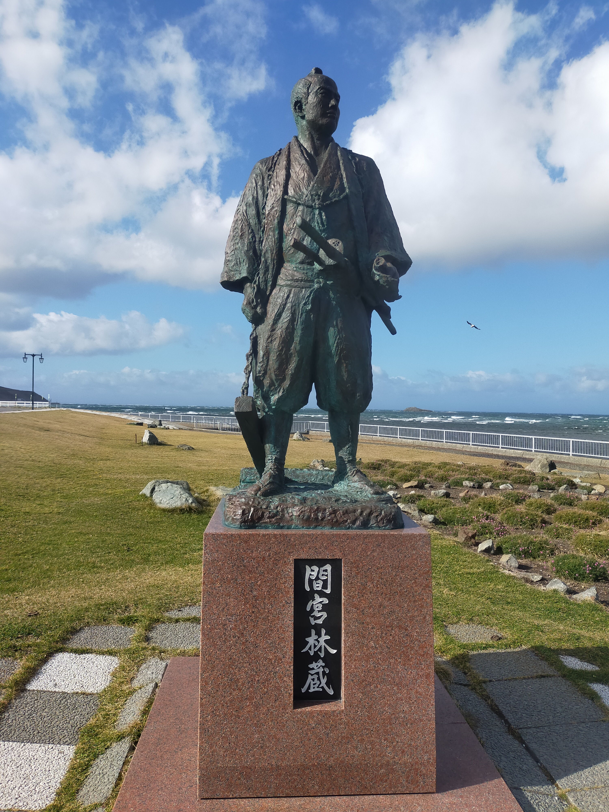
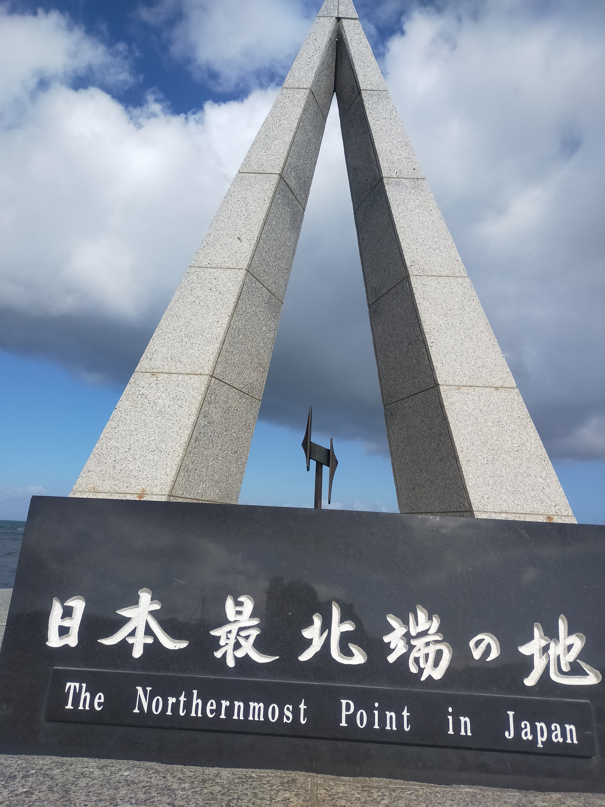
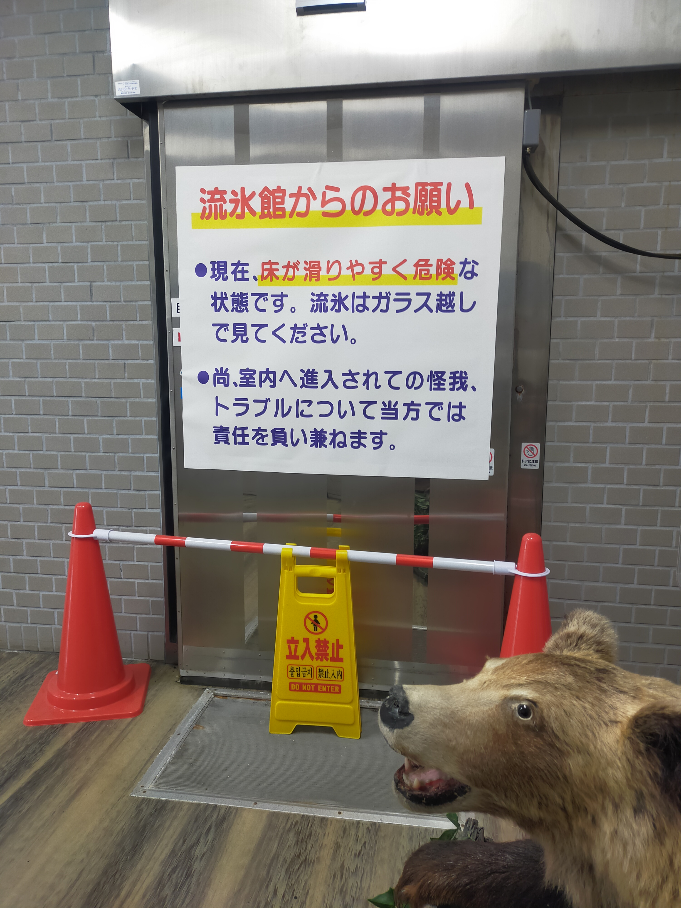
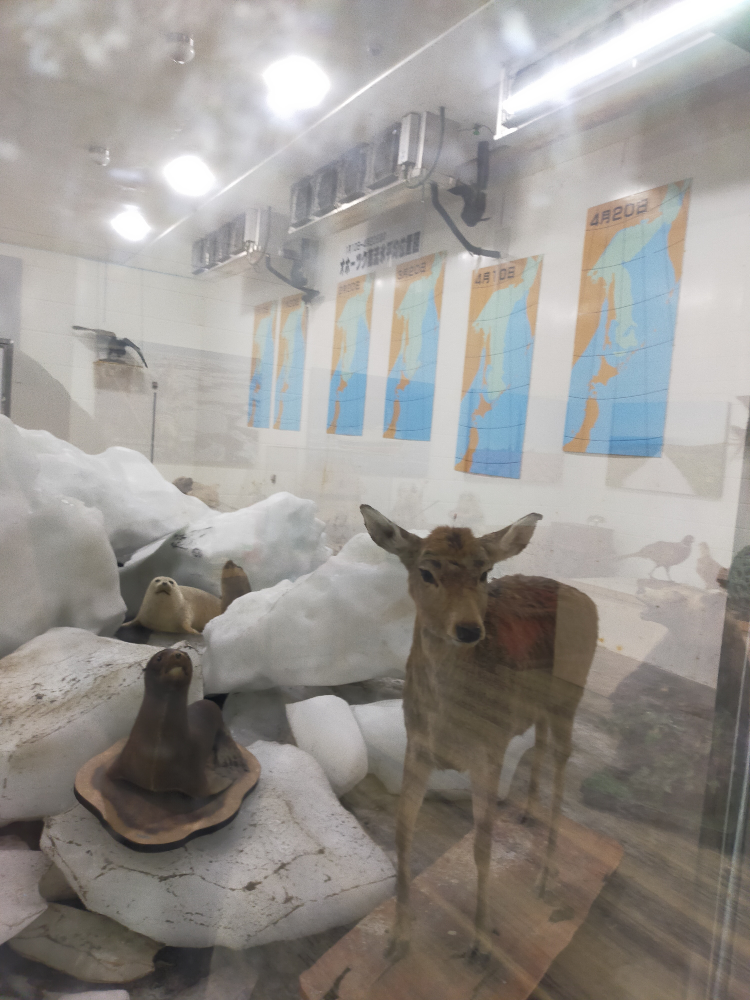
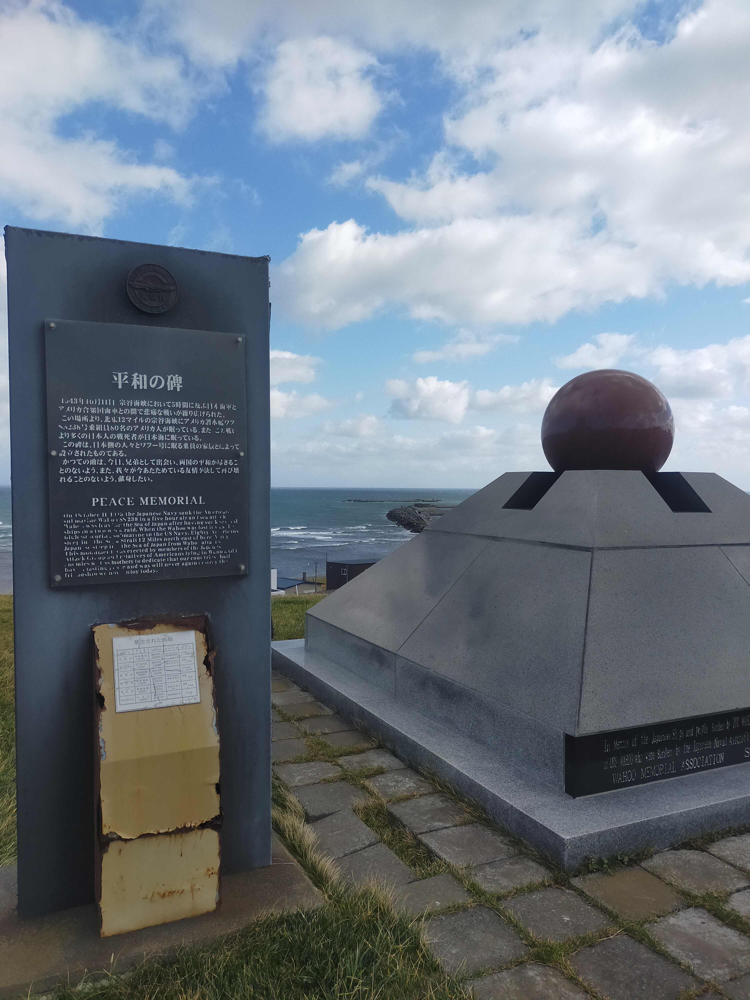
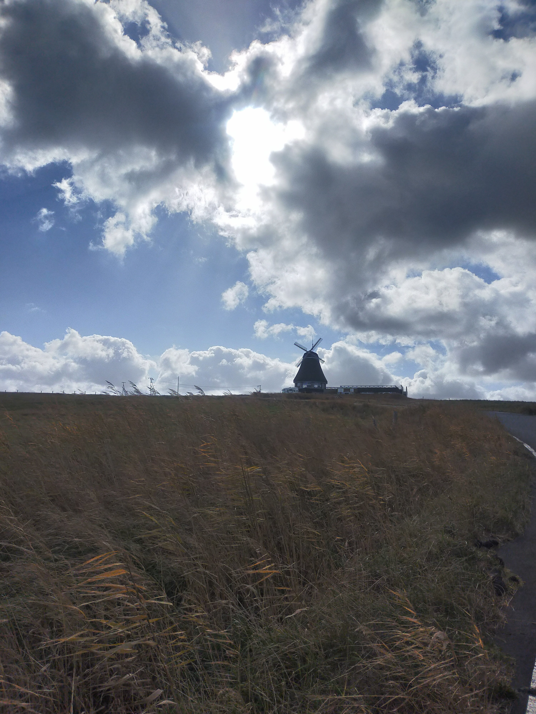
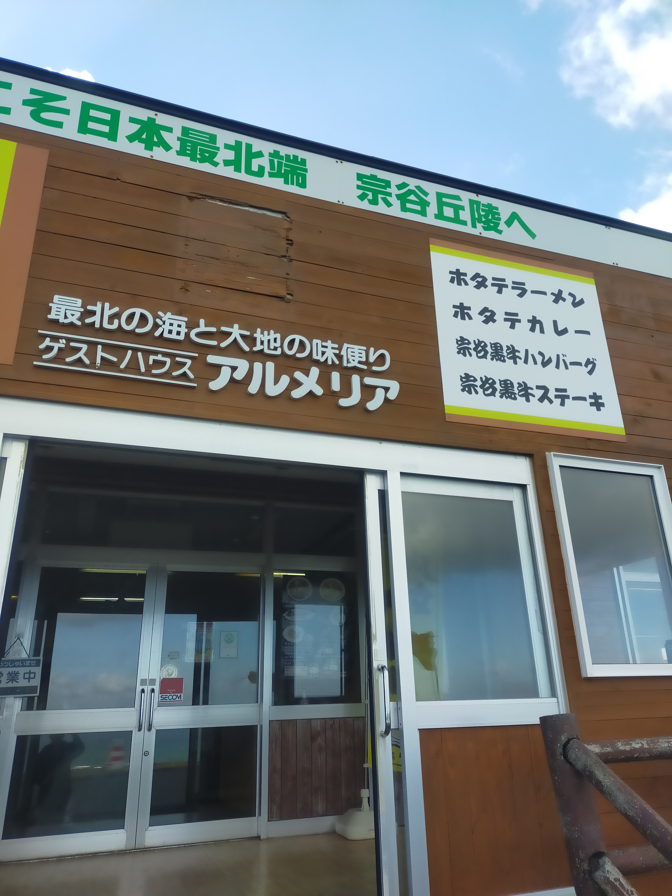
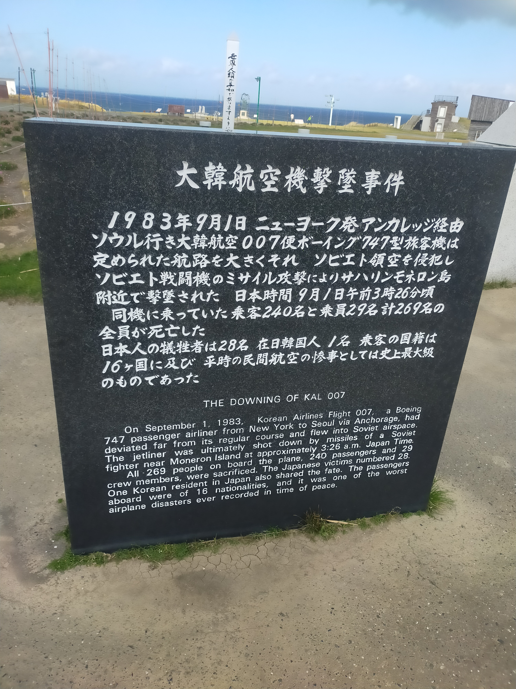
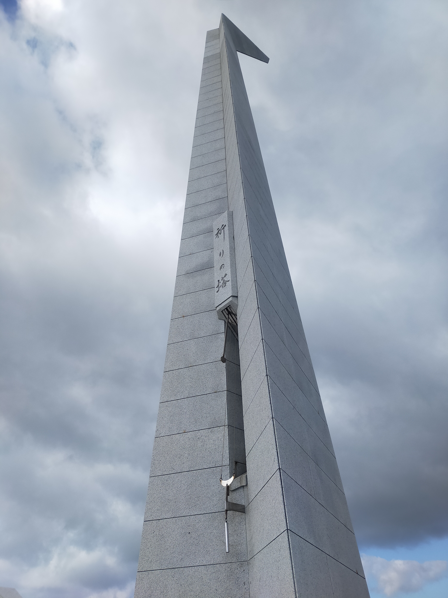
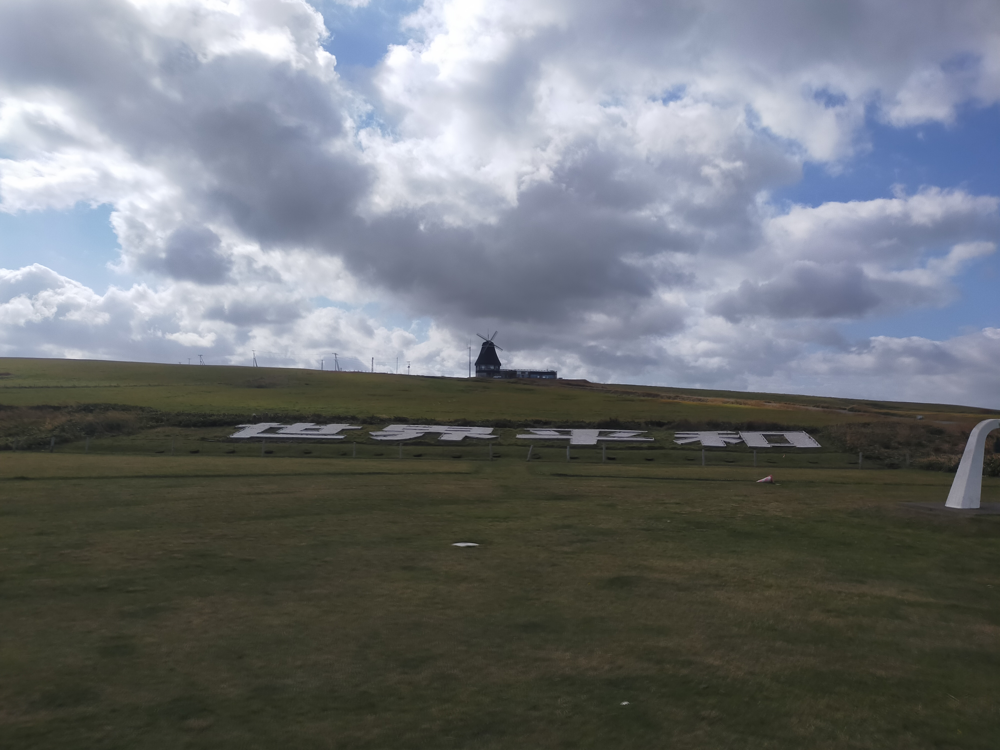

+++
title = "宗谷岬にはがっかり"
date = 2026-11-11T00:00:00+09:00
draft = false
tags = ["船", "仕事", "観光" ]
+++
今日は、12時から16時のワッチをしました。
朝ごはんを食べてから、昼まで少し寝てから入ったので元気でした。
しかし、即応待機なため、本当にやることがなく、何のための仕事なんだか。と思いました。
途中で、やることがなさ過ぎて、1時間くらい積と商の微分について、証明をしていました。
合成関数の微分の証明は、出来ませんでした。
明日もう一回やってみようと思います。

今日は、朝ご飯の後、縦付けの停泊のときにやる仕事を教えてもらったので、それを記しておきます。
- 大きいフェンダーは両舷につける
- 小さいフェンダーは下の紐を引っ張って船体を覆うようにつける
- 階段は自転車が入っていた倉庫の中にある
- あゆみの手すりはいつもより、2本多い
- あゆみには黄色いロープを使う

今日は、前回の停泊中に行った宗谷岬のことについて書こうと思います。
結論としては、稚内に初停泊した時のノシャップ岬側の方が断然面白かったです。
何故なら、ノシャップ岬側には、資料館もあるし、タワーもあって、眺望もよかったからです。

グーグルマップは何故か宗谷バスを知らないので、一応行き方も記しておきます。
1日に４往復程、稚内駅、南稚内駅などから、宗谷岬までのバスが出ています。私は、9時30頃のバスを利用しました。
そこから、１時間ほどで片道1500円程度です。

宗谷岬そのものには、ほとんど何もありません。流氷館は立ち入り禁止でした。おみやげも大したものはありませんでした。
そこから少し山を登ったところに海軍の物見櫓、日韓航空機の慰霊碑、さらに行ったところに風車付きのレストランがあるだけです。
天気がよくてがっかりだったので、ほとんどの人はがっかりするんじゃないでしょうか。

テキトーすぎる流氷館（入場無料）

ここらの景色が一番良かったです。

クソ不愉快な世界平和ゾーン

先輩方が稚内ははずれ停泊地って言っていた意味が少しわかりました。
確かに、宗谷岬は全然だめです。