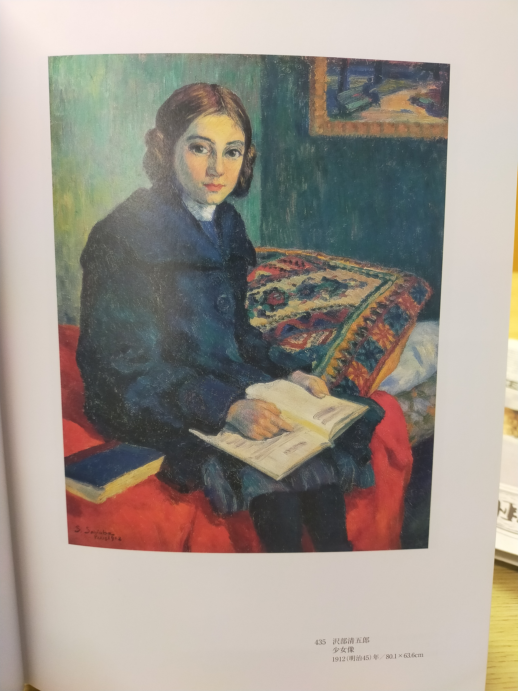
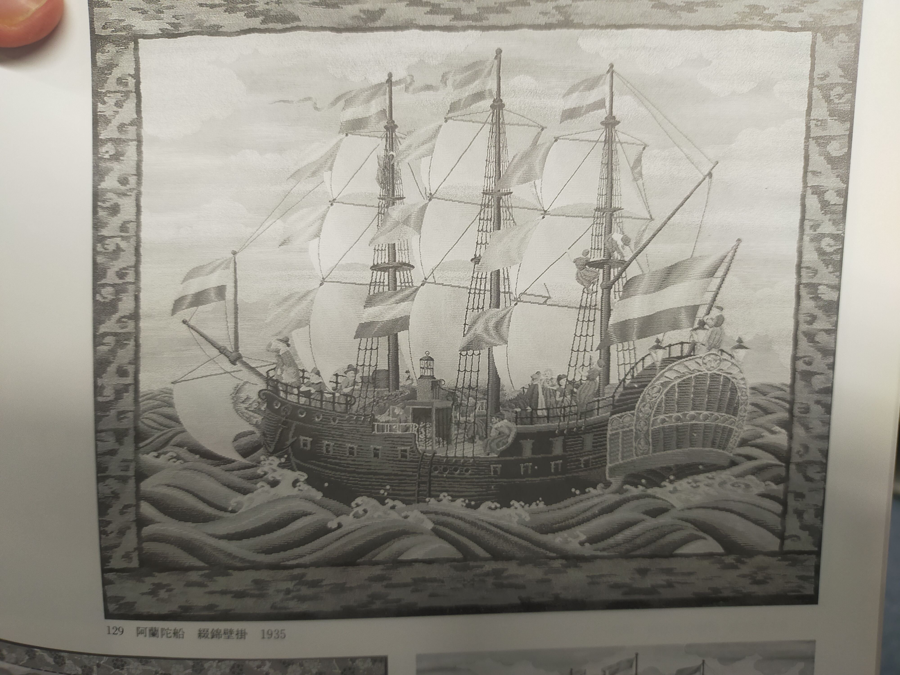

+++
title = "敗戦処理とつくばDASH"
date = 2026-11-25T00:00:00+09:00
draft = false
tags = ["休日"]
+++
今日は、朝から流山免許センターに行きました。
免許証の再交付を受ける為です。
顔写真、パスポート、住民票と2600円あれば、即日交付でした。
流山免許センターは柏駅からバスで行きます。柏駅から大宮行の東武アーバンパークラインに乗って、流山おおたかの森駅まで行きます。
そこからつくばエクスプレスに乗車して、1時間ほどでつくばに着きました。
昼はいどうじに行きました。極みどりと、替え玉を頼んで、1290円でした。昔は、いどうじ高いなと思っていました。しかし、物価高の影響で、安いな。頑張ってるなと思うようになりました。この前稚内で、チャーハンと餃子で1500円取られたのは戦慄でした。

その後は、体育芸術の図書館に行きました。美術の図録を閲覧するためです。
京都国立近代美術館の洋画図録を閲覧していたら、沢部清五郎という画家を知りました。

油絵も色彩がいいと思いました。

装飾織物もやっていたそうで、凄い刺繍が残っていました。

美術の世界はそもそも知られていないことが多いのと、それを紹介できる人が少ないです。なので、まだまだ掘りがいがあるなぁと思います。

そこからは、天久保3に住んでいる友人と再会して、呑み会に連れて行ってもらいました。デイズタウンの焼き鳥屋です。女の子が二人も来て珍しかったです。
初めて代行を使いました。

つくばでの暗黒本の対面販売を予定している事、私の広島訪問の予定などを打合せしました。
兎に角広島訪問の日程や、暗黒本の刷り上がりを確認したかったので、最速でいくことにしたんです。
